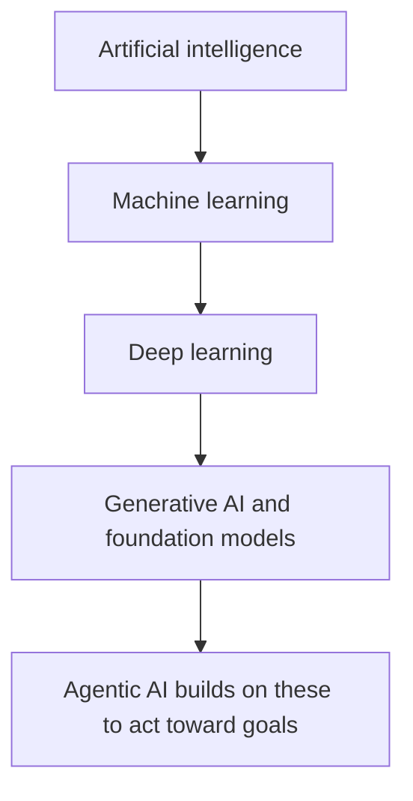

# Explain basic AI concepts and terminologies

This task covers the vocabulary every other AIF-C01 domain builds on: what AI, ML, deep learning, generative AI and agentic AI mean, how models are trained and served, what kinds of data they use, and how they learn. Expect many short, definition-style questions, so precise wording matters.

## Key concepts

**Core terms.** Artificial intelligence (AI) is the broad goal of systems that perform tasks we associate with human intelligence. Machine learning (ML) is a branch of AI where algorithms learn patterns from data instead of following hand-written rules. A **model** is the result of training an **algorithm** on data. **Training** builds the model; **inferencing** uses the trained model to produce predictions or output for new input.

**Deep learning and neural networks.** A neural network is a set of connected layers of nodes. Deep learning uses networks with many layers and is especially good with images, audio and text. It usually needs a lot of data and compute.

**Fields of AI.** Computer vision interprets images and video. Natural language processing (NLP) works with human language in text or speech, for example sentiment analysis or translation.

**Generative and agentic AI.** Generative AI (GenAI) creates new content such as text, images or code. It is typically powered by foundation models, and a large language model (LLM) is a foundation model trained on huge amounts of text. Agentic AI describes autonomous systems that pursue predefined goals with limited human oversight. AWS describes them as proactive, adaptable and collaborative, often built from several specialized agents that hand off tasks.

**Bias, fairness and fit.** Bias is systematic skew in a model's results, often inherited from unrepresentative training data. Fairness means outcomes do not unjustifiably disadvantage a group. An **overfit** model memorizes training data and generalizes poorly. An **underfit** model is too simple and performs poorly everywhere.

## How the terms relate

## Types of inferencing

- **Real-time:** low-latency responses from an always-on endpoint, for interactive use.
- **Batch:** processes many inputs together when nobody is waiting, such as scoring a stored dataset overnight.
- **Asynchronous:** queues requests; suits large payloads and long processing times with near real-time needs.
- **Serverless:** no infrastructure to manage and scales with traffic; suits intermittent traffic that can tolerate cold starts.

## Types of data

- **Labeled** data includes the correct answer; **unlabeled** data does not.
- **Structured** data has a fixed schema; **tabular** data is structured data in rows and columns.
- **Unstructured** data has no fixed schema: text, images, audio, video.
- **Time-series** data is ordered by time, such as sensor readings or sales per day.

## Types of learning

- **Supervised:** learns from labeled data (classification, regression).
- **Unsupervised:** finds structure in unlabeled data (clustering, anomaly detection).
- **Reinforcement:** an agent learns by trial and error from rewards and penalties.

## Key terms

| Term             | Meaning                                                    |
| ---------------- | ---------------------------------------------------------- |
| Model            | The artifact produced by training an algorithm on data     |
| Training         | Learning patterns from data to build a model               |
| Inferencing      | Using a trained model on new input                         |
| Foundation model | Large model trained on broad data, adaptable to many tasks |
| LLM              | Foundation model for understanding and generating language |
| Overfitting      | Good on training data, poor on unseen data                 |

## Comparisons

| Concept       | Key idea                                          | Typical signal in a question              |
| ------------- | ------------------------------------------------- | ----------------------------------------- |
| Generative AI | Creates new content from a prompt                 | "generate", "draft", "summarize"          |
| Agentic AI    | Plans and acts toward a goal with little guidance | "autonomous", "calls tools", "multi-step" |
| Supervised    | Labeled examples                                  | "historical outcomes", "known labels"     |
| Unsupervised  | No labels                                         | "segments", "unusual patterns"            |
| Reinforcement | Rewards and penalties                             | "trial and error", "policy"               |

## Exam tips

- Read for the input type: images point to computer vision, language points to NLP.
- Labels in the scenario mean supervised; no labels and grouping means unsupervised; rewards mean reinforcement.
- Match inference to latency and payload: interactive is real-time, bulk offline is batch, large or long jobs are asynchronous, idle gaps are serverless.
- Do not confuse learning types (how a model learns) with fields (what data it works on).
- Training happens before inference; a question about "using the model" is about inference.

## Learn more

- [What is AI? - Artificial Intelligence Explained - AWS](https://aws.amazon.com/what-is/artificial-intelligence/)
- [What is Machine Learning? - ML Technology Explained - AWS](https://aws.amazon.com/what-is/machine-learning/)
- [What is Computer Vision? - Image recognition AI/ML Explained - AWS](https://aws.amazon.com/what-is/computer-vision/)
- [What is Natural Language Processing? - NLP Explained - AWS](https://aws.amazon.com/what-is/nlp/)
- [What Is Unsupervised Learning? - Unsupervised Machine Learning Explained - AWS](https://aws.amazon.com/what-is/unsupervised-learning/)
- [What is Agentic AI? - Agentic AI Explained - AWS](https://aws.amazon.com/what-is/agentic-ai/)
- [What is Generative AI? - Gen AI Explained - AWS](https://aws.amazon.com/what-is/generative-ai/)
- [What are Foundation Models? - Foundation Models in Generative AI Explained - AWS](https://aws.amazon.com/what-is/foundation-models/)
- [What is LLM? - Large Language Models Explained - AWS](https://aws.amazon.com/what-is/large-language-model/)
- [Deploy models for inference - Amazon SageMaker AI](https://docs.aws.amazon.com/sagemaker/latest/dg/deploy-model.html)
- [Real-time inference - Amazon SageMaker AI](https://docs.aws.amazon.com/sagemaker/latest/dg/realtime-endpoints.html)
- [Process multiple prompts with batch inference - Amazon Bedrock](https://docs.aws.amazon.com/bedrock/latest/userguide/batch-inference.html)
- [Types of Algorithms - Amazon SageMaker AI](https://docs.aws.amazon.com/sagemaker/latest/dg/algorithms-choose.html)
