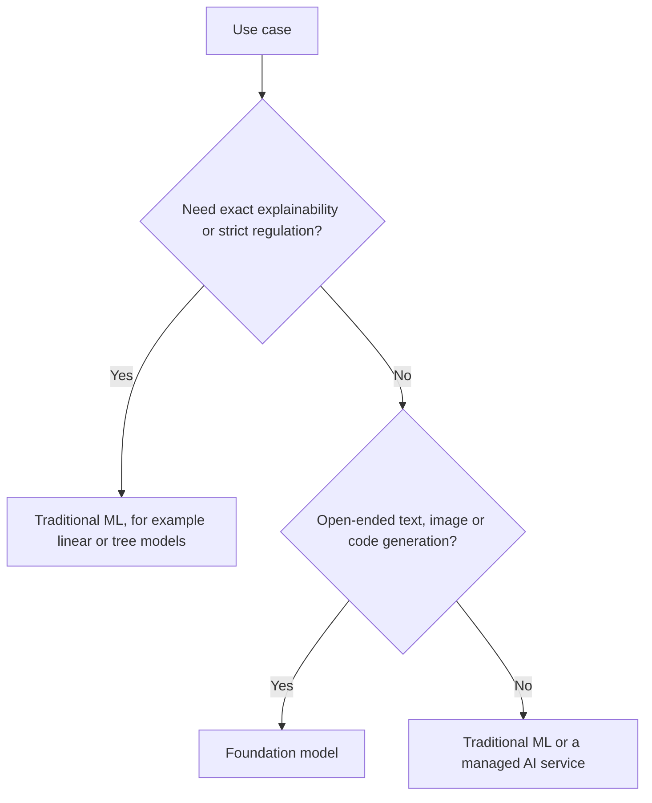

# Identify practical use cases for AI

This task asks you to judge where AI and machine learning (ML) fit, where they do not, which technique matches a problem, and which AWS managed service delivers a capability. Exam questions are usually short business scenarios, so the skill is matching a stated need to the right idea or service.

## Key concepts

### Where AI/ML adds value

AI/ML helps when a problem has patterns that are hard to write as fixed rules and when data is available to learn from. Typical benefits:

- **Assisting human decisions:** a model scores loan risk or flags suspicious transactions, and a person makes the final call.
- **Scalability:** a model can review millions of images, documents or support tickets that no team could read.
- **Automation:** repetitive judgment tasks, such as routing emails or extracting fields from forms, run without manual effort.

### When AI/ML is not appropriate

- **A specific outcome is required, not a prediction.** A tax formula or a legal threshold must give the same exact answer every time. Use deterministic code or rules, because a model only estimates.
- **The cost outweighs the benefit.** A task done a few times a month by hand may not justify the data, build, hosting and monitoring cost of a model.
- **There is not enough suitable data**, or the errors would be unacceptable and cannot be reviewed.

### Matching a technique to a problem

| Technique      | Learning type | Predicts                  | Example                              |
| -------------- | ------------- | ------------------------- | ------------------------------------ |
| Regression     | Supervised    | A continuous number       | House price, demand forecast         |
| Classification | Supervised    | A category                | Spam or not spam, fraud or not fraud |
| Clustering     | Unsupervised  | Natural groups, no labels | Customer segments                    |

### Real-world applications

- **Computer vision:** defect detection, face or object recognition in images and video.
- **Natural language processing (NLP):** sentiment, entities, summarization, translation.
- **Speech recognition:** turning audio into text.
- **Recommendation systems:** suggesting products or content.
- **Fraud detection and forecasting:** spotting unusual activity, predicting future values.
- **Knowledge bases:** answering questions from company documents.
- **Agentic AI:** systems that plan steps and use tools to complete a goal.

### AWS managed AI services

| Service             | Capability                                               |
| ------------------- | -------------------------------------------------------- |
| Amazon SageMaker AI | Build, train and deploy your own ML models               |
| Amazon Transcribe   | Speech to text                                           |
| Amazon Polly        | Text to lifelike speech                                  |
| Amazon Translate    | Language translation                                     |
| Amazon Comprehend   | NLP insights: sentiment, entities, key phrases, language |
| Amazon Lex          | Conversational chatbots with voice and text              |
| Amazon Kendra       | Intelligent enterprise search over documents             |

### Traditional ML or foundation models

Traditional models trained on your labeled data suit narrow, well-defined tasks. They are often cheaper to run, faster and easier to explain. Foundation models (FMs) suit broad or generative tasks, with little task-specific data, but they cost more per request and are harder to explain.

## Key terms

| Term                  | Meaning                                           |
| --------------------- | ------------------------------------------------- |
| Supervised learning   | Learning from labeled examples                    |
| Unsupervised learning | Finding structure in unlabeled data               |
| Regression            | Predicting a continuous value                     |
| Classification        | Predicting a category                             |
| Clustering            | Grouping similar items without labels             |
| Foundation model      | A large pre-trained model adaptable to many tasks |

## Comparisons

- **Transcribe vs Polly:** Transcribe turns speech into text; Polly turns text into speech.
- **Comprehend vs Translate:** Comprehend analyzes text meaning; Translate converts it between languages.
- **Lex vs Kendra:** Lex runs a conversation flow; Kendra searches documents.
- **SageMaker AI vs managed AI services:** SageMaker AI is for custom models; the others are ready-made APIs.

## Exam tips

- If the answer must be exact and identical every time, the correct choice is rules, not AI.
- A number as output points to regression; a label points to classification; "no labels" points to clustering.
- Pick the prebuilt service when it meets the need, and SageMaker AI only when a custom model is required.
- Regulation or explainability requirements favor simpler traditional models.

## Learn more

- [What is AI? - Artificial Intelligence Explained - AWS](https://aws.amazon.com/what-is/artificial-intelligence/)
- [What is Machine Learning? - ML Technology Explained - AWS](https://aws.amazon.com/what-is/machine-learning/)
- [What is Computer Vision? - Image recognition AI/ML Explained - AWS](https://aws.amazon.com/what-is/computer-vision/)
- [What is Natural Language Processing? - NLP Explained - AWS](https://aws.amazon.com/what-is/nlp/)
- [What Is Unsupervised Learning? - Unsupervised Machine Learning Explained - AWS](https://aws.amazon.com/what-is/unsupervised-learning/)
- [Types of Algorithms - Amazon SageMaker AI](https://docs.aws.amazon.com/sagemaker/latest/dg/algorithms-choose.html)
- [Amazon Transcribe – Speech to Text - AWS](https://aws.amazon.com/transcribe/)
- [Machine Translation Service — Amazon Translate — Amazon Web Services](https://aws.amazon.com/translate/)
- [Natural Language Processing – Amazon Comprehend – AWS](https://aws.amazon.com/comprehend/)
- [AI Voice Generator and Text-to-Speech Tool - Amazon Polly - AWS](https://aws.amazon.com/polly/)
- [Enterprise Search Engine - Amazon Kendra - AWS](https://aws.amazon.com/kendra/)
