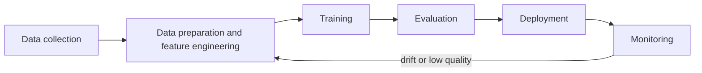

# Describe the AI/ML development lifecycle

This task covers how an ML or generative AI solution moves from an idea to a monitored production system. The exam expects you to name the pipeline stages, choose where a model comes from, pick how to serve it, and judge it with both model metrics and business metrics.

## Key concepts

### Components of an ML pipeline

An ML pipeline is a repeatable sequence of stages. Each stage feeds the next, and the last one loops back to the start.

- **Data collection and preparation:** gather data from sources, clean it, and engineer features.
- **Training and tuning:** fit the model and adjust hyperparameters. Experimentation means trying different models and tracking each run.
- **Evaluation:** measure the model on data it has not seen before deployment.
- **Deployment:** expose the model so applications can request predictions.
- **Monitoring:** watch live quality and trigger retraining or new experiments.

### Sources of foundation models

- **Open source pre-trained models:** publicly released models you can use as they are or fine-tune. They save compute, time and data.
- **Proprietary pre-trained models from providers:** accessed through a managed service such as Amazon Bedrock.
- **Custom models trained by you:** needed when no existing model fits your data or task. They cost the most in data, compute and expertise.

Starting from a pre-trained model is usually faster and cheaper, but it does not guarantee the best accuracy for your task. You still evaluate it.

### Using a model in production

- **Managed API service:** the provider runs the infrastructure and you call an API. Amazon Bedrock is the example. You do little capacity planning, patching or scaling.
- **Self-hosted API:** you deploy the model on your own endpoint, for example an Amazon SageMaker AI endpoint, and you choose the instance types and scaling. You gain control and customization but take on more operations.
- **Real-time versus batch:** real-time endpoints answer individual requests with low latency. Batch inference scores large datasets on a schedule when immediate answers are not needed.

### AWS services by stage

- **Amazon SageMaker AI:** a managed service to build, train, and deploy ML models, including your own custom models.
- **Amazon Bedrock:** managed access to foundation models through an API, for generative AI applications.
- **Amazon Quick and Kiro:** AI-powered tools for end users and developers that sit on top of the lifecycle rather than training your models. Know their names as they appear in the exam objectives.
- **SageMaker Model Monitor:** watches data quality, model quality, bias drift and feature attribution drift in production.

### MLOps fundamentals

MLOps applies DevOps ideas to ML. Core practices are:

- **Experimentation:** track runs, data and model versions.
- **Repeatable processes:** automate data preparation, training, validation and deployment, and use version control.
- **Scalable systems:** use reusable components and infrastructure as code.
- **Technical debt:** avoid ad hoc scripts and untracked data that make systems hard to change.
- **Production readiness:** validate, document and govern models before release.
- **Monitoring and re-training:** detect drift and retrain when quality drops.

### Evaluating models

Model performance metrics for classification:

- **Accuracy:** correct predictions divided by all predictions. It misleads when classes are imbalanced.
- **Precision:** of the items predicted positive, how many really are.
- **Recall:** of the real positives, how many the model found.
- **F1 score:** the harmonic mean of precision and recall, useful when both matter.

Business metrics show whether the model is worth running: cost per user, development costs, customer feedback and return on investment (ROI).

## Key terms

| Term                | Meaning                                                          |
| ------------------- | ---------------------------------------------------------------- |
| Feature engineering | Turning raw data into inputs a model can learn from              |
| Data drift          | Production data changes from what the model was trained on       |
| Model registry      | Central store that tracks model versions and approval status     |
| Fine-tuning         | Further training a pre-trained model on your own data            |
| Batch inference     | Scoring many records in one job instead of one request at a time |

## Comparisons

| Option                              | You manage                    | Best when                                        |
| ----------------------------------- | ----------------------------- | ------------------------------------------------ |
| Managed API (Amazon Bedrock)        | Prompts and application logic | You want fast access with little operations work |
| Self-hosted (SageMaker AI endpoint) | Model, instances, scaling     | You need custom models or control over hosting   |

| Metric    | Question it answers                  |
| --------- | ------------------------------------ |
| Precision | How many flagged items were correct? |
| Recall    | How many true cases were caught?     |
| F1 score  | Is the balance of both acceptable?   |

## Exam tips

- A question about declining quality weeks after launch points to monitoring and re-training.
- With rare positive cases such as fraud, accuracy is a trap. Look for recall, precision or F1.
- Cost per user, ROI and customer feedback are business metrics, not model metrics.
- "Least operational overhead" usually favors a managed API; "full control" favors self-hosting.

## Learn more

- [What is Machine Learning? - ML Technology Explained - AWS](https://aws.amazon.com/what-is/machine-learning/)
- [What is MLOps? - Machine Learning Operations Explained - AWS](https://aws.amazon.com/what-is/mlops/)
- [What is Amazon SageMaker AI? - Amazon SageMaker AI](https://docs.aws.amazon.com/sagemaker/latest/dg/whatis.html)
- [Machine Learning Service – Amazon Sagemaker AI – AWS](https://aws.amazon.com/sagemaker/ai/)
- [Data and model quality monitoring with Amazon SageMaker Model Monitor - Amazon SageMaker AI](https://docs.aws.amazon.com/sagemaker/latest/dg/model-monitor.html)
- [Deploy models for inference - Amazon SageMaker AI](https://docs.aws.amazon.com/sagemaker/latest/dg/deploy-model.html)
- [Evaluating your ML project with the MLOps checklist - AWS Prescriptive Guidance](https://docs.aws.amazon.com/prescriptive-guidance/latest/mlops-checklist/introduction.html)
- [Machine Learning Lens - AWS Well-Architected Framework - Machine Learning Lens](https://docs.aws.amazon.com/wellarchitected/latest/machine-learning-lens/machine-learning-lens.html)
