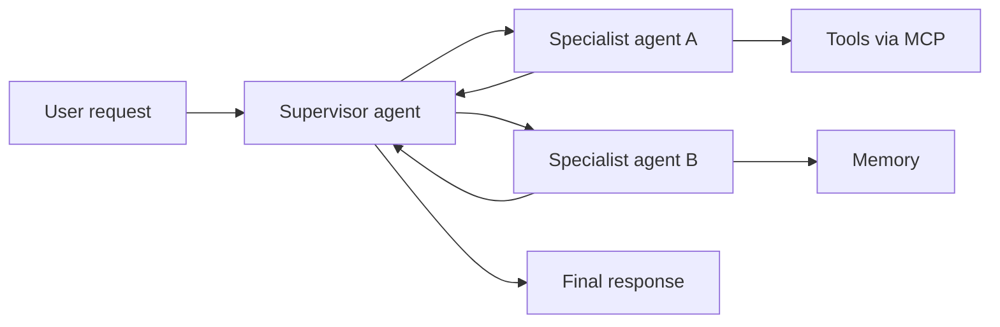

# Explain the basic concepts of generative AI (GenAI)

This task covers the vocabulary and building blocks of generative AI: how foundation models work, what they are used for, how they are built, how inference is priced, and how agentic AI extends them. The exam expects you to recognize these terms in short scenarios and match them to the right concept.

## Key concepts

### Foundational GenAI concepts

- **Foundation models (FMs)** are large neural networks pre-trained on broad data, usually with self-supervised learning, then adapted to many tasks. **Large language models (LLMs)** are FMs built on the **transformer** architecture, which uses attention to relate tokens to each other.
- A **token** is a unit of text (a word, part of a word, or punctuation) that the model reads and generates. A **context window** is the maximum number of tokens a model can handle in one request.
- An **embedding** is a **vector** of numbers that captures meaning. Similar content gets nearby vectors, which powers semantic search.
- **Chunking** splits documents into smaller pieces before they are embedded and stored, so retrieval returns only relevant passages.
- **Prompt engineering** shapes output through instructions, roles, formats, and examples, with no retraining.
- **Multi-modal models** handle more than one data type, such as text and images. **Diffusion models** generate images (and other media) by learning to remove noise step by step.

### Use cases

GenAI creates new content: image, video, and audio generation; summarization; AI assistants; translation; code generation; customer service agents; semantic search; and recommendation experiences. Predicting a number or assigning a label from structured data is usually traditional machine learning.

### FM lifecycle

Data selection, model selection, pre-training, fine-tuning, evaluation, deployment, and feedback. Most teams start with an existing FM, so they skip pre-training and focus on choosing a model, adapting it with curated data, evaluating it against their own criteria, and using feedback to improve.

### Token-based pricing

On-demand inference is billed per token, with separate rates for input and output tokens that vary by model. More tokens mean higher cost and usually higher latency, so shorter prompts, limited response length, and a right-sized model reduce both. **Provisioned Throughput** in Amazon Bedrock instead reserves model units at an hourly rate, giving consistent throughput and predictable cost for steady workloads.

### Context engineering

A model sees only its training and the current context window. Context engineering is deciding what goes into that window for each step: system instructions, retrieved content, conversation history or memory, and tool definitions, while staying within token limits. Overloading the context raises cost and can reduce accuracy.

### Agentic AI

Agentic systems use an FM to reason toward a goal, choose steps, and take actions.

- **Tool usage:** agents call APIs, functions, or databases to act beyond the model's built-in knowledge.
- **Model Context Protocol (MCP):** an open standard for connecting agents to external tools and data, so one integration (an MCP server) can be reused.
- **Memory management:** short-term memory keeps turn-by-turn context in a session; long-term memory keeps facts and preferences across sessions (Amazon Bedrock AgentCore Memory offers both).
- **Multi-agent systems:** specialist agents collaborate, often coordinated by a supervisor agent that plans, delegates, and combines results.
- **Workflow orchestration:** coordinating the steps, tools, and agents needed to finish a task.

## Key terms

| Term                | Meaning                                                             |
| ------------------- | ------------------------------------------------------------------- |
| Token               | Unit of text a model reads and generates; the basis of pricing      |
| Embedding / vector  | Numeric representation of meaning used for similarity search        |
| Chunking            | Splitting documents into smaller pieces for embedding and retrieval |
| Fine-tuning         | Further training a pre-trained model on a smaller domain dataset    |
| Context engineering | Choosing what information is placed in the model's context window   |
| MCP                 | Open protocol that connects agents to external tools and data       |
| Supervisor agent    | Agent that plans and delegates to collaborator agents               |

## Comparisons

| Concept            | Compare with           | Difference                                                                                            |
| ------------------ | ---------------------- | ----------------------------------------------------------------------------------------------------- |
| Pre-training       | Fine-tuning            | Pre-training learns general patterns from huge data; fine-tuning specializes with a small curated set |
| Prompt engineering | Fine-tuning            | Prompting changes the input only; fine-tuning changes model weights                                   |
| On-demand          | Provisioned Throughput | Per-token, flexible pay-as-you-go versus reserved capacity at an hourly rate                          |
| Short-term memory  | Long-term memory       | Within one session versus across sessions                                                             |
| Transformer LLM    | Diffusion model        | Predicts next tokens (text) versus denoises to create images                                          |

## Exam tips

- "Smallest change without retraining" usually points to prompt engineering; "consistent style across many examples" may point to fine-tuning.
- Cost scenarios hinge on tokens: reduce prompt size, response length, or model size. Steady, high-volume traffic points to Provisioned Throughput.
- If a question mentions connecting an agent to many external systems with a standard interface, think MCP.
- Distinguish memory (persisting information) from context window (what fits in one request).
- Do not confuse embeddings (meaning as vectors) with tokens (text units).

## Learn more

- [What is Generative AI? - Gen AI Explained - AWS](https://aws.amazon.com/what-is/generative-ai/)
- [What are Foundation Models? - Foundation Models in Generative AI Explained - AWS](https://aws.amazon.com/what-is/foundation-models/)
- [What is LLM? - Large Language Models Explained - AWS](https://aws.amazon.com/what-is/large-language-model/)
- [How content chunking works for knowledge bases - Amazon Bedrock](https://docs.aws.amazon.com/bedrock/latest/userguide/kb-chunking.html)
- [Amazon Bedrock Pricing](https://aws.amazon.com/bedrock/pricing/)
- [What is Agentic AI? - Agentic AI Explained - AWS](https://aws.amazon.com/what-is/agentic-ai/)
- [Model Context Protocol strategies on AWS - AWS Prescriptive Guidance](https://docs.aws.amazon.com/prescriptive-guidance/latest/mcp-strategies/introduction.html)
- [Add memory to your Amazon Bedrock AgentCore agent - Amazon Bedrock AgentCore](https://docs.aws.amazon.com/bedrock-agentcore/latest/devguide/memory.html)
- [Multi-agent collaboration - AWS Prescriptive Guidance](https://docs.aws.amazon.com/prescriptive-guidance/latest/agentic-ai-patterns/multi-agent-collaboration.html)
