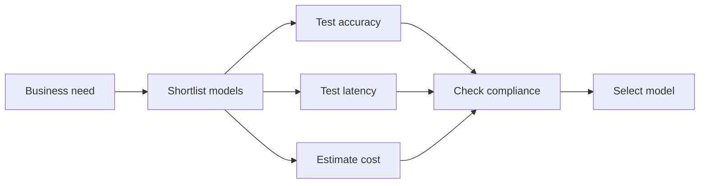

# Understand the capabilities and limitations of GenAI for solving business problems

This task covers what generative AI (GenAI) does well, where it falls short, how to pick a foundation model for a use case, and how to show business value. Exam questions usually describe a business need and ask you to name the relevant advantage, risk, selection factor, or metric.

## Key concepts

### Advantages of GenAI

- **Adaptability.** Foundation models are trained on broad data, so one model can be prompted or customized for summarizing, translating, answering questions, and more, instead of building a separate model per task.
- **Responsiveness.** Applications can respond immediately and at any hour, which helps with customer service and employee help desks.
- **Conversational capabilities.** Users interact in natural language, so assistants and chatbots are easier to use and adapt their replies to each user's wording.
- **Ability to generate content.** GenAI creates text, images, code, and synthetic data, which speeds up drafting, prototyping, and research.

### Disadvantages and limitations

- **Hallucinations and inaccuracy.** A model predicts likely content, not verified truth, so it can state wrong or unsupported information confidently. Mitigations include grounding responses in trusted data, human review, and safeguards such as the contextual grounding check in Amazon Bedrock Guardrails, which scores responses for grounding in a source and relevance to the query.
- **Interpretability.** Large models behave like black boxes, so explaining how a specific output was produced is hard. This matters in regulated decisions.
- **Nondeterminism.** The same prompt can produce different outputs, which is a problem when results must be repeatable.
- **Other concerns.** Bias from training data, privacy concerns when customizing with proprietary data, limited true originality, and substantial compute cost.

GenAI is not always the right tool. For exact, repeatable, auditable logic, deterministic code or rules are a better fit.

### Selecting a GenAI model

Match model characteristics to requirements:

- **Model type and modality** (text, image, embedding, multimodal).
- **Performance requirements** such as accuracy and quality.
- **Capabilities and constraints**, for example supported tasks and context length.
- **Compliance** and data handling obligations.
- **Cost.** Amazon Bedrock pricing depends on modality, provider, and model, and usage is largely measured in input and output tokens.
- **Latency** for interactive use.
- **Model complexity.** Larger models are often more capable but slower and more expensive.

Test candidates on representative data, then choose the simplest model that meets the requirements.

### Business value and metrics

Link technical results to business outcomes:

- **Efficiency**, such as time saved per task or cost per resolved contact.
- **Conversion rate**, the share of users who complete a desired action.
- **Average revenue per user (ARPU)**, revenue per user in a period.
- **Customer lifetime value (CLV)**, expected total value of a customer over the relationship.
- **Accuracy** and **cross-domain performance**, meaning how well one solution works across different areas of the business.
- **ROI**, the measurable benefit compared with the total cost of building and running the solution.

## Key terms

| Term             | Meaning                                                               |
| ---------------- | --------------------------------------------------------------------- |
| Foundation model | A large model trained on broad data that can be adapted to many tasks |
| Hallucination    | Fluent output that is incorrect or not supported by the source        |
| Interpretability | How well people can understand why a model produced an output         |
| Nondeterminism   | Variation in output for the same input                                |
| Grounding        | Basing a response on trusted source information                       |
| Latency          | Time taken to return a response                                       |
| ROI              | Return on investment: benefit compared with cost                      |

## Comparisons

| Metric            | Measures                                                   |
| ----------------- | ---------------------------------------------------------- |
| Conversion rate   | Share of visitors who complete a desired action            |
| ARPU              | Revenue per user in a period                               |
| CLV               | Expected total value of a customer over time               |
| Latency, accuracy | Technical performance, not business outcomes by themselves |

## Exam tips

- Map the scenario to one advantage or limitation: "explain the decision" points to interpretability, "different answers each time" points to nondeterminism, "confident but wrong" points to hallucination.
- When a smaller model meets the stated requirements, it is usually preferred over a larger one because of cost and latency.
- Business metrics such as conversion rate and CLV beat technical statistics, such as parameter count, when the question asks about value.
- Regulated workloads make compliance and explainability decisive selection factors.
- Do not pick GenAI when the requirement is exact, repeatable, auditable logic.

## Learn more

- [What is Generative AI? - Gen AI Explained - AWS](https://aws.amazon.com/what-is/generative-ai/)
- [What are Foundation Models? - Foundation Models in Generative AI Explained - AWS](https://aws.amazon.com/what-is/foundation-models/)
- [What is LLM? - Large Language Models Explained - AWS](https://aws.amazon.com/what-is/large-language-model/)
- [Generative AI on AWS – Generative AI, LLMs, and Foundation Models – AWS](https://aws.amazon.com/ai/generative-ai/)
- [Amazon Bedrock Pricing](https://aws.amazon.com/bedrock/pricing/)
- [Generative AI Lens - AWS Well-Architected Framework - Generative AI Lens](https://docs.aws.amazon.com/wellarchitected/latest/generative-ai-lens/generative-ai-lens.html)
- [Use contextual grounding check to filter hallucinations in responses - Amazon Bedrock](https://docs.aws.amazon.com/bedrock/latest/userguide/guardrails-contextual-grounding-check.html)
