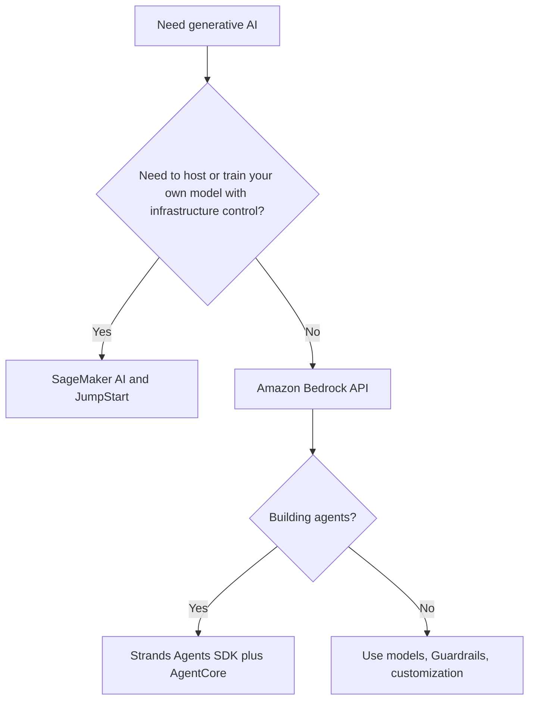

# Describe AWS infrastructure and technologies for building GenAI applications

This task covers which AWS services and features you use to build generative AI applications, why managed services are attractive, what AWS infrastructure adds in security and responsibility, and how pricing choices trade cost against performance. Expect scenario questions that ask you to pick a service or a pricing mode from a short requirement.

## Key concepts

### Services and features for building GenAI applications

- **Amazon Bedrock** is a fully managed service that gives API access to foundation models from Amazon and other leading providers. There are no servers to manage. Around the models it offers features such as Guardrails, customization, and tools for agents.
- **Amazon SageMaker AI** is a managed service to build, train, and deploy ML models and foundation models. Choose it when you need control over training, instance types, and hosting.
- **Amazon SageMaker JumpStart** is a hub of pretrained models, including foundation models, inside SageMaker AI. You deploy them to endpoints and can fine-tune them.
- **Strands Agents** is an open-source SDK, originally released by AWS, for building agents with a model-first approach. It supports tools, multi-agent patterns, and the Model Context Protocol (MCP).
- **Amazon Bedrock AgentCore** is a platform to deploy and operate agents securely at scale with any framework and any model. Its modular services include Runtime, Memory, Gateway, Identity, Code Interpreter, Browser, and Observability.
- **Amazon Quick** is an AI-powered assistant for work (research, business insights, automation). **Kiro** is an IDE for AI-native coding. Both are applications and tools you use, rather than platforms for hosting your own models.

### Advantages of AWS GenAI services

Managed services lower the barrier to entry because developers call pretrained models through APIs and need not train models or run GPU clusters. They improve efficiency and speed to market, widen accessibility to non-ML teams, and let you pay for usage instead of buying hardware. They also help meet business objectives by letting you try different models and customize them for a use case.

### Benefits of AWS infrastructure

AWS states that Amazon Bedrock never stores or uses your data to train models. Data is encrypted in transit and at rest, identity-based policies control access, and monitoring and logging support governance and audit. Bedrock is in scope for standards such as ISO, SOC, and GDPR, and is HIPAA eligible. Responsibility and safety are supported by Amazon Bedrock Guardrails and the Well-Architected Generative AI Lens. Security remains a shared responsibility.

### Cost tradeoffs

- **On-demand**: no commitment. Many text models bill per token, with input and output tokens priced separately.
- **Batch**: asynchronous, lower rate than on-demand, for certain models only.
- **Provisioned Throughput**: reserved capacity in model units, billed hourly, with no commitment, one-month, or six-month terms. Longer terms cost less per hour. A customized model must use it.
- **Cross-Region inference**: routes requests to other Regions for more capacity. Pricing varies by routing scope.
- **Priority and Flex tiers**: Priority costs more for higher service priority. Flex costs less for delay-tolerant work.
- **Custom models**: customization adds training, storage, and inference costs, and not every model is available in every Region.

## Key terms

| Term                   | Meaning                                                                  |
| ---------------------- | ------------------------------------------------------------------------ |
| Foundation model       | Large pretrained model adaptable to many tasks                           |
| Token                  | Unit of text a model processes; the usual billing unit for on-demand     |
| Model unit             | Capacity unit purchased with Provisioned Throughput                      |
| Guardrails             | Configurable safeguards on model inputs and outputs                      |
| MCP                    | Model Context Protocol, a standard way to give tools and context to LLMs |
| Cross-Region inference | Routing of requests to other Regions to raise available capacity         |

## Comparisons

| Need                                          | Best fit                |
| --------------------------------------------- | ----------------------- |
| API access to many models, minimal operations | Amazon Bedrock          |
| Own model, instance and endpoint control      | SageMaker AI, JumpStart |
| Open-source agent code                        | Strands Agents          |
| Secure hosting and operation of agents        | AgentCore               |
| Unpredictable traffic, no commitment          | Bedrock on-demand       |
| Steady high volume, or a customized model     | Provisioned Throughput  |
| Large offline job, lowest cost                | Batch inference         |

## Exam tips

- "Serverless, multiple providers, API" points to Amazon Bedrock. "Control the infrastructure" points to SageMaker AI.
- Strands Agents builds agents. AgentCore runs and governs them. They are complementary, not alternatives.
- A fine-tuned model in Bedrock needs Provisioned Throughput.
- Match pricing to traffic shape: variable means on-demand, steady means provisioned, offline means batch.
- Answers claiming guaranteed accuracy, guaranteed lowest cost, or no customer responsibility are wrong.

## Learn more

- [Overview - Amazon Bedrock](https://docs.aws.amazon.com/bedrock/latest/userguide/what-is-bedrock.html)
- [Amazon Bedrock – Build genAI applications and agents at production scale – AWS](https://aws.amazon.com/bedrock/)
- [Amazon Bedrock Pricing](https://aws.amazon.com/bedrock/pricing/)
- [Increase model invocation capacity with Provisioned Throughput in Amazon Bedrock - Amazon Bedrock](https://docs.aws.amazon.com/bedrock/latest/userguide/prov-throughput.html)
- [What is Amazon SageMaker AI? - Amazon SageMaker AI](https://docs.aws.amazon.com/sagemaker/latest/dg/whatis.html)
- [Amazon SageMaker JumpStart Foundation Models - Amazon SageMaker AI](https://docs.aws.amazon.com/sagemaker/latest/dg/jumpstart-foundation-models.html)
- [Overview - Amazon Bedrock AgentCore](https://docs.aws.amazon.com/bedrock-agentcore/latest/devguide/what-is-bedrock-agentcore.html)
- [Strands Agents - AWS Prescriptive Guidance](https://docs.aws.amazon.com/prescriptive-guidance/latest/agentic-ai-frameworks/strands-agents.html)
- [Generative AI on AWS – Generative AI, LLMs, and Foundation Models – AWS](https://aws.amazon.com/ai/generative-ai/)
