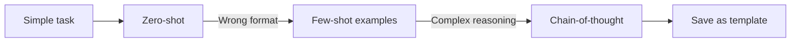

# Choose effective prompt engineering techniques

Prompt engineering is the practice of shaping the text you send to a foundation model so it returns the output you want. This task covers the building blocks of a prompt, the main techniques, best practices, the security risks that come with prompts, and how Amazon Bedrock Prompt management versions and reuses them. Expect scenario questions that ask which technique or control fits a stated problem.

## Key concepts

### Prompt constructs

A prompt combines some of these parts:

- **Instruction**: the task the model should perform, such as "Summarize the review in one sentence."
- **Context**: background that guides how the model uses the input, such as "The following is text from a restaurant review."
- **Input data**: the text the model works on.
- **Demonstration examples**: paired example inputs and outputs.
- **Negative prompt**: a statement of what the output should avoid, such as topics or styles to exclude.

### Techniques

- **Zero-shot**: the task only, no examples.
- **Single-shot**: one example pair.
- **Few-shot**: several example pairs. Also called in-context learning. The model's weights do not change.
- **Chain-of-thought**: ask the model to work through intermediate reasoning steps before the final answer. It helps with multi-step logic and arithmetic.
- **Prompt templates**: a reusable prompt with placeholders for the parts that change, such as the input text. Templates may include instructions, few-shot examples and context.

### Benefits and best practices

Good prompts improve response quality and give developers more control over how users interact with the model. Recommended practices:

- Be specific, clear and concise. Remove ambiguity and unrelated text.
- Describe the output you want, such as its length or format.
- Put the instruction or question at the end, after reference text.
- Give a default answer for when the model is unsure, such as "I don't know."
- Experiment: change one thing at a time, and keep a hold-out test set that is separate from the examples you tuned on.
- Reuse tested prompts as templates.
- Add guardrails: prompts steer a model, but they do not enforce safety, so combine them with Amazon Bedrock Guardrails.

Inference parameters such as temperature, top-p and maximum tokens also shape output. Lower temperature gives more deterministic answers.

### Risks and limitations

- **Prompt injection or hijacking**: user input that overrides the developer's instructions, for example "Ignore everything earlier."
- **Jailbreaking**: prompts designed to bypass the model's built-in safety and moderation.
- **Exposure (prompt leakage)**: tricking the model into revealing its system prompt or other confidential configuration.
- **Poisoning**: malicious or biased content placed in the data a model trains on or draws from, which corrupts its output.
- **Limitations**: output is probabilistic, differs between models, and prompts cannot guarantee that hallucinations never occur.

Prompt injection is an application-level concern that the customer owns. Defenses include input validation, a clearly scoped system prompt, security testing, and an Amazon Bedrock Guardrails prompt attack filter. When calling InvokeModel, wrap user input in guardrail input tags so the filter evaluates it. Never put secrets in a prompt.

### Prompt management

Amazon Bedrock Prompt management lets you create, edit, test and reuse prompts. A prompt can include variables, a model and inference settings. Saving updates a working draft. Creating a version takes a snapshot you can deploy, so production stays stable while you keep editing the draft, and you can switch back to an earlier version. You can compare prompt variants side by side. Applications use a saved prompt when running model inference or through a prompt node in Amazon Bedrock Flows.

## Key terms

| Term                | Meaning                                                                        |
| ------------------- | ------------------------------------------------------------------------------ |
| Shot                | One paired example of an input and its desired output                          |
| In-context learning | Learning a pattern from examples placed in the prompt                          |
| Variable            | A placeholder filled in at test time or runtime                                |
| Prompt variant      | An alternative configuration of a prompt, including message, model or settings |
| Version             | A snapshot of a prompt taken at a point in time                                |
| Draft               | The working copy that you keep iterating on                                    |

## Comparisons

| Attack                       | Goal                                                   |
| ---------------------------- | ------------------------------------------------------ |
| Jailbreak                    | Bypass the model's own safety rules                    |
| Prompt injection (hijacking) | Override the developer's instructions                  |
| Prompt leakage (exposure)    | Reveal the system prompt or confidential configuration |

- Few-shot prompting changes the prompt only. Fine-tuning changes the model and costs more effort.
- Draft is for iteration. A version is for deployment.

## Exam tips

- Count the examples: none is zero-shot, one is single-shot, several is few-shot.
- "Reasoning steps" or "multi-step problem" points to chain-of-thought.
- "Reuse one prompt with changing values" points to a prompt template or Prompt management variables.
- "Roll back" or "keep production stable" points to prompt versions.
- "Compare wordings or models" points to prompt variants.
- "Ignore earlier instructions" is injection. "Reveal your instructions" is exposure. "Bypass safety" is jailbreaking.
- Prompting alone cannot guarantee safety. The best answer often adds Guardrails.

## Learn more

- [Prompt engineering concepts - Amazon Bedrock](https://docs.aws.amazon.com/bedrock/latest/userguide/prompt-engineering-guidelines.html)
- [Design a prompt - Amazon Bedrock](https://docs.aws.amazon.com/bedrock/latest/userguide/design-a-prompt.html)
- [What is Prompt Engineering? - AI Prompt Engineering Explained - AWS](https://aws.amazon.com/what-is/prompt-engineering/)
- [Influence response generation with inference parameters - Amazon Bedrock](https://docs.aws.amazon.com/bedrock/latest/userguide/inference-parameters.html)
- [Construct and store reusable prompts with Prompt management in Amazon Bedrock - Amazon Bedrock](https://docs.aws.amazon.com/bedrock/latest/userguide/prompt-management.html)
- [Create a prompt using Prompt management - Amazon Bedrock](https://docs.aws.amazon.com/bedrock/latest/userguide/prompt-management-create.html)
- [Prompt injection security - Amazon Bedrock](https://docs.aws.amazon.com/bedrock/latest/userguide/prompt-injection.html)
- [Detect prompt attacks with Amazon Bedrock Guardrails - Amazon Bedrock](https://docs.aws.amazon.com/bedrock/latest/userguide/guardrails-prompt-attack.html)
- [Prompt engineering best practices to avoid prompt injection attacks on modern LLMs - AWS Prescriptive Guidance](https://docs.aws.amazon.com/prescriptive-guidance/latest/llm-prompt-engineering-best-practices/introduction.html)
