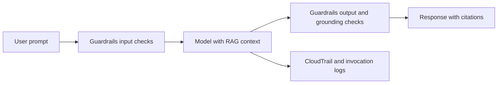

# Explain methods to secure AI systems

Securing an AI system means protecting its identities, data, network paths, models, prompts and outputs, and being able to show where its data and models came from. This task covers the AWS services that help, security and privacy risks specific to generative AI, and techniques that improve output accuracy. Expect scenario questions that ask which control fits a stated risk.

## Key concepts

### Identity, access and shared responsibility

- **Shared responsibility:** AWS secures the infrastructure that runs managed AI services. You secure your IAM permissions, data, encryption choices, guardrail settings and how the application uses model output.
- **IAM:** give applications IAM roles with least-privilege policies that allow only the needed Amazon Bedrock actions. Avoid long-lived keys, shared users and root credentials.
- **Amazon Bedrock AgentCore Identity** manages workload identities and credentials for agents, so an agent can call AWS or third-party services on behalf of a user without secrets in its code.
- **Policy in AgentCore** evaluates each agent request at the AgentCore Gateway against deterministic Cedar policies, outside the agent's code, before a tool is allowed.

### Data protection and network controls

- **Encryption at rest** uses AWS Key Management Service keys (customer managed keys give you control over rotation and key policy). **Encryption in transit** uses TLS.
- **AWS PrivateLink** interface VPC endpoints keep traffic to Amazon Bedrock on the AWS network.
- **Amazon Macie** discovers sensitive data such as PII in Amazon S3, useful before training or retrieval.
- **Amazon Bedrock Guardrails** filter prompts and responses: content filters (including prompt attacks and toxic content), denied topics, word filters, sensitive information filters (block or mask PII) and contextual grounding checks.

### Security and privacy risks

- **Prompt injection:** crafted input overrides instructions. Use input validation, prompt attack detection and least-privilege tool access rather than relying on prompt wording.
- **Data leakage:** prevented by access control on data sources, output filtering and encryption.
- **Audit and logging:** AWS CloudTrail records API calls; Amazon Bedrock model invocation logging can capture prompts and responses. Protect those logs because they can hold sensitive text.
- Also consider application security, vulnerability management, threat detection and infrastructure protection, as for any workload.

### Documenting origins

Source citations show users which documents back an answer. Data lineage and data cataloging record where data came from and how it changed. **Amazon SageMaker Model Cards** document a model's intended use, risk rating, training details and evaluation results for audits.

### Secure data engineering

Assess data quality, control access with least privilege, protect integrity so data is not altered unnoticed, and apply privacy-enhancing techniques such as masking, anonymization and data minimization.

### Hallucination and grounding

Ground answers with RAG so the model uses trusted retrieved content, validate outputs, use contextual grounding checks or confidence scores, and add human review for high-risk answers.

## Key terms

| Term             | Meaning                                                        |
| ---------------- | -------------------------------------------------------------- |
| Least privilege  | Granting only the permissions needed for a task                |
| Prompt injection | Input crafted to override a model's instructions               |
| Data lineage     | A record of where data came from and how it was transformed    |
| Grounding        | Basing responses on trusted source content                     |
| Hallucination    | A fluent but unsupported or false model output                 |
| Model card       | A document of a model's purpose, training, evaluation and risk |

## Comparisons

| Need                                          | Choose                                   |
| --------------------------------------------- | ---------------------------------------- |
| Private network path to Amazon Bedrock        | AWS PrivateLink                          |
| Find PII stored in Amazon S3                  | Amazon Macie                             |
| Mask PII in prompts and responses             | Guardrails sensitive information filters |
| Detect unsupported RAG answers                | Guardrails contextual grounding checks   |
| Agent credentials for users and third parties | AgentCore Identity                       |
| Rules on which tools an agent may call        | Policy in AgentCore                      |
| Document model purpose and risk               | SageMaker Model Cards                    |
| Who called the model and when                 | AWS CloudTrail                           |

## Exam tips

- Match the control to the layer: network (PrivateLink), identity (IAM, AgentCore Identity), content (Guardrails), data discovery (Macie), keys (AWS KMS).
- A better prompt alone is rarely the correct defense against prompt injection or leakage; look for enforced controls.
- Guardrails sensitive information filters protect inputs and outputs; Macie scans stored data in S3.
- Hallucination answers usually mention RAG grounding, output validation or grounding checks, not higher temperature.
- Watch for options that grant broad permissions, hard-code secrets or disable encryption or logging; these are wrong.

## Learn more

- [What is IAM? - AWS Identity and Access Management](https://docs.aws.amazon.com/IAM/latest/UserGuide/introduction.html)
- [Identity and access management for Amazon Bedrock - Amazon Bedrock](https://docs.aws.amazon.com/bedrock/latest/userguide/security-iam.html)
- [AWS Key Management Service - AWS Key Management Service](https://docs.aws.amazon.com/kms/latest/developerguide/overview.html)
- [What is AWS PrivateLink? - Amazon Virtual Private Cloud](https://docs.aws.amazon.com/vpc/latest/privatelink/what-is-privatelink.html)
- [Detect and filter harmful content by using Amazon Bedrock Guardrails - Amazon Bedrock](https://docs.aws.amazon.com/bedrock/latest/userguide/guardrails.html)
- [Remove PII from conversations by using sensitive information filters - Amazon Bedrock](https://docs.aws.amazon.com/bedrock/latest/userguide/guardrails-sensitive-filters.html)
- [Provide identity and credential management for agent applications with Amazon Bedrock AgentCore Identity - Amazon Bedrock AgentCore](https://docs.aws.amazon.com/bedrock-agentcore/latest/devguide/identity.html)
- [Policy in Amazon Bedrock AgentCore: Control Agent Interactions - Amazon Bedrock AgentCore](https://docs.aws.amazon.com/bedrock-agentcore/latest/devguide/policy.html)
- [Amazon SageMaker Model Cards - Amazon SageMaker AI](https://docs.aws.amazon.com/sagemaker/latest/dg/model-cards.html)
- [Security - Generative AI Lens](https://docs.aws.amazon.com/wellarchitected/latest/generative-ai-lens/security.html)
