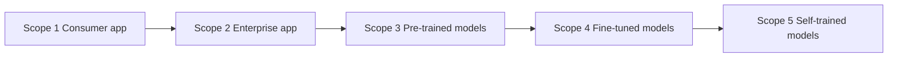

# Recognize governance and compliance regulations for AI systems

AI systems must meet legal, regulatory, and internal requirements. This task covers the AWS services that provide compliance evidence, the data governance strategies that control how data is handled, and the processes organizations follow to govern AI. Expect scenario questions that ask you to match a requirement to the right service or strategy.

## Key concepts

### AWS services for governance and compliance

Under the shared responsibility model, AWS demonstrates the compliance of its infrastructure, and you demonstrate the compliance of your own workloads. Different services supply different kinds of evidence:

- **AWS Artifact** is the portal for on-demand AWS compliance reports (such as third-party audit reports) and agreements. Amazon Bedrock documentation points to it for audit reports.
- **AWS CloudTrail** records API calls and account activity: who called what, when, and from where. Amazon Bedrock is integrated with it, and operations such as InvokeModel and Converse appear as management events. A trail delivers events to Amazon S3 for long-term retention.
- **AWS Config** records resource configurations and their changes over time and evaluates them against rules, so noncompliant resources are flagged.
- **Amazon Inspector** scans workloads such as EC2 instances, container images, and Lambda functions for software vulnerabilities.
- **AWS Trusted Advisor** checks an account against AWS best practices and recommends improvements in categories such as cost optimization, security, fault tolerance, and performance.

### Data governance strategies

Data governance spans the whole data lifecycle for training data, prompts, and outputs:

- **Data lifecycle and retention:** define how long data is kept and when it is archived or deleted.
- **Logging:** record who accessed data and which model calls were made, so activity can be audited.
- **Residency:** keep data stored and processed in the Regions that laws require.
- **Monitoring and observation:** watch models and data in production for abnormal behavior, drift, and bias.
- **Quality and protection:** curated training data should meet quality requirements and be secured throughout development.

### Governance processes and frameworks

Governance is a continuing process, not a one-time sign-off:

- **Policies:** written rules such as acceptable-use policies for AI tools.
- **Review cadence and strategies:** regular audits of AI behavior and scheduled policy reviews with accountable owners, often through a cross-functional board or team.
- **Transparency standards:** documentation of what a model is for and how it was evaluated, for example Amazon SageMaker Model Cards.
- **Team training:** educating staff on data exposure and AI risks.
- **Frameworks:** standards such as ISO/IEC 42001 (AI management systems) and the NIST AI framework, plus AWS guidance such as the Generative AI Security Scoping Matrix.

The Generative AI Security Scoping Matrix classifies a use case into one of five scopes by how much you own, then applies security disciplines (governance and compliance, legal and privacy, risk management, controls, resilience) to each:

Ownership and responsibility grow from left to right.

## Key terms

| Term                  | Meaning                                                                         |
| --------------------- | ------------------------------------------------------------------------------- |
| Data lifecycle        | The stages of data from collection through use, archiving, and deletion.        |
| Data retention        | Policy for how long data must be kept before deletion.                          |
| Data residency        | Requirement that data stay in a specific geographic location.                   |
| Model card            | Structured documentation of a model's purpose, risks, and evaluation.           |
| Review cadence        | The scheduled frequency of policy and audit reviews.                            |
| Shared responsibility | AWS secures the cloud infrastructure; you govern and secure what you run in it. |

## Comparisons

| Need                                               | Service             |
| -------------------------------------------------- | ------------------- |
| Download AWS audit reports                         | AWS Artifact        |
| Who made which API call                            | AWS CloudTrail      |
| Resource configuration history and rule compliance | AWS Config          |
| Software vulnerability scanning                    | Amazon Inspector    |
| Account best-practice recommendations              | AWS Trusted Advisor |

- **Scope 3 vs Scope 4:** both build on a third-party foundation model, but Scope 4 fine-tunes it with your own data.
- **Retention vs residency:** retention is about how long, residency is about where.

## Exam tips

- Match the verb to the service: "report" points to Artifact, "who called" to CloudTrail, "configuration" to Config, "vulnerability" to Inspector, "recommendation" to Trusted Advisor.
- If the scenario asks about evidence for AWS itself, think Artifact. If it asks about your own resources, think Config or CloudTrail.
- Scope questions turn on ownership: using a public app is Scope 1, fine-tuning with your data is Scope 4, training from scratch is Scope 5.
- Governance answers favor repeatable, documented processes (reviews, training, documentation) over one-time or informal ones.

## Learn more

- [Responsible AI – Building AI Responsibly – AWS](https://aws.amazon.com/ai/responsible-ai/)
- [What Is AI Governance? - AI Governance Explained - AWS](https://aws.amazon.com/what-is/ai-governance/)
- [Securing generative AI: An introduction to the Generative AI Security Scoping Matrix | AWS Security Blog](https://aws.amazon.com/blogs/security/securing-generative-ai-an-introduction-to-the-generative-ai-security-scoping-matrix/)
- [Generative AI Lens - AWS Well-Architected Framework - Generative AI Lens](https://docs.aws.amazon.com/wellarchitected/latest/generative-ai-lens/generative-ai-lens.html)
- [What Is AWS CloudTrail? - AWS CloudTrail](https://docs.aws.amazon.com/awscloudtrail/latest/userguide/cloudtrail-user-guide.html)
- [Monitor Amazon Bedrock API calls using CloudTrail - Amazon Bedrock](https://docs.aws.amazon.com/bedrock/latest/userguide/logging-using-cloudtrail.html)
- [Compliance validation for Amazon Bedrock - Amazon Bedrock](https://docs.aws.amazon.com/bedrock/latest/userguide/compliance-validation.html)
- [Best Practice Guidance for AWS Optimization - AWS Trusted Advisor](https://aws.amazon.com/premiumsupport/technology/trusted-advisor/)
