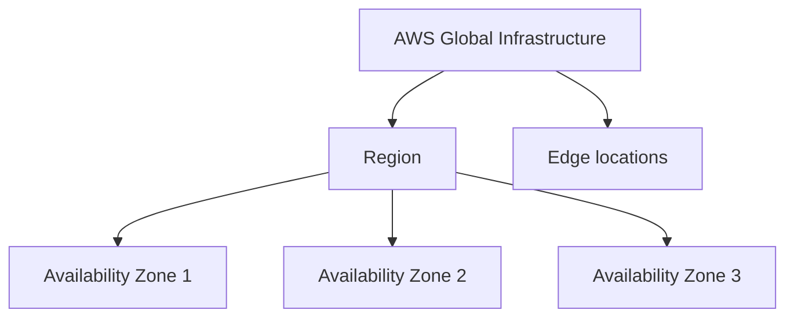

# Define the benefits of the AWS Cloud

This task covers why organizations move to the cloud and what makes the AWS Cloud different from running your own data centers. Expect scenario questions that describe a business problem and ask you to name the cloud advantage, the infrastructure concept, or the design characteristic that solves it.

## Key concepts

### Value proposition of the AWS Cloud

AWS describes six advantages of cloud computing:

1. **Trade fixed expense for variable expense.** Instead of investing heavily in data centers and servers up front, you pay only for what you consume.
2. **Benefit from massive economies of scale.** Aggregated usage from many customers lets AWS achieve lower costs, which become lower pay-as-you-go prices.
3. **Stop guessing capacity.** You no longer forecast demand and buy hardware ahead of time. You scale up or down within minutes.
4. **Increase speed and agility.** New resources are a few clicks away, so experiments cost little in time and money.
5. **Stop spending money running and maintaining data centers.** AWS handles the facilities, so your team can focus on customers and applications.
6. **Go global in minutes.** You can deploy in multiple Regions around the world without building anything yourself.

### Benefits of global infrastructure

The AWS Global Infrastructure is organized in layers:

- An **AWS Region** is a separate geographic area. Each Region is isolated from the others.
- An **Availability Zone (AZ)** is one or more discrete data centers with redundant power, networking, and connectivity inside a Region. Each Region has multiple AZs, connected by low-latency links.
- **Edge locations** cache content close to end users for faster delivery.

This design gives you **global reach** (place workloads near users to reduce latency), **speed of deployment** (use existing Regions instead of building facilities), **data residency control** (customer content stays in the Region you choose unless you move it), and **resilience** (a failure in one AZ or Region does not have to take down your application).

### High availability, elasticity, and agility

- **High availability** means the workload keeps running with minimal downtime when components fail. You achieve it by removing single points of failure, adding redundancy, spreading resources across multiple AZs, and using health checks to route traffic to healthy resources.
- **Elasticity** means capacity grows and shrinks automatically with demand. Amazon EC2 Auto Scaling launches instances when load rises and terminates them when load falls, so you avoid both idle capacity and overload.
- **Agility** means you can provision, change, and discard resources quickly. Time to make resources available drops from weeks to minutes, which encourages experimentation.

## Key terms

| Term                    | Meaning                                                                      |
| ----------------------- | ---------------------------------------------------------------------------- |
| Pay-as-you-go           | Paying only for the resources you use, with no upfront hardware purchase.    |
| Economies of scale      | Lower unit costs from aggregating usage across a very large customer base.   |
| AWS Region              | A separate geographic area that contains multiple Availability Zones.        |
| Availability Zone       | One or more discrete data centers in a Region, isolated from other AZs.      |
| Edge location           | A site that caches content close to users to reduce latency.                 |
| High availability       | Design that keeps a workload operating with minimal downtime during failure. |
| Elasticity              | Automatically acquiring and releasing resources as demand changes.           |
| Agility                 | Speed at which teams can provision resources and try new ideas.              |
| Single point of failure | A component whose failure stops the whole system.                            |

## Comparisons

| Concept           | Question it answers                         | Typical AWS example                      |
| ----------------- | ------------------------------------------- | ---------------------------------------- |
| High availability | Does it stay up when something fails?       | Instances in multiple Availability Zones |
| Elasticity        | Does capacity follow demand?                | Amazon EC2 Auto Scaling                  |
| Agility           | How fast can we build and experiment?       | Provisioning an environment in minutes   |
| Global reach      | How close are we to users and legal limits? | Choosing Regions near customers          |

- A **Region** is a geographic area; an **Availability Zone** is a location inside a Region. Multi-AZ improves availability; multi-Region improves reach and can address distance or regional-failure scenarios.
- **Variable expense** is about how you pay; **economies of scale** is about how low the price can be; **stop guessing capacity** is about sizing.

## Exam tips

- Match the keyword to the advantage: "pay only for what you use" is variable expense; "lower prices because of volume" is economies of scale; "no more forecasting" is stop guessing capacity; "launch in minutes" is agility or go global in minutes.
- If a question asks about surviving a data center failure, the answer involves multiple Availability Zones, not a bigger instance.
- If a question asks about adding and removing capacity with demand, think elasticity and Auto Scaling, not high availability.
- If data must stay in a country, pick a Region in that country and do not replicate outside it.
- Cloud does not guarantee zero downtime. Customers still design for failure.

## Learn more

- [Six advantages of cloud computing - Overview of Amazon Web Services](https://docs.aws.amazon.com/whitepapers/latest/aws-overview/six-advantages-of-cloud-computing.html)
- [Global infrastructure - Overview of Amazon Web Services](https://docs.aws.amazon.com/whitepapers/latest/aws-overview/global-infrastructure.html)
- [Overview of Amazon Web Services](https://docs.aws.amazon.com/whitepapers/latest/aws-overview/introduction.html)
- [What is Cloud Computing? - Cloud Computing Services, Benefits, and Types - AWS](https://aws.amazon.com/what-is-cloud-computing/)
- [What is High Availability? - High Availability Systems Explained - AWS](https://aws.amazon.com/what-is/high-availability/)
- [What is Amazon EC2 Auto Scaling? - Amazon EC2 Auto Scaling](https://docs.aws.amazon.com/autoscaling/ec2/userguide/what-is-amazon-ec2-auto-scaling.html)
- [Reliability - AWS Well-Architected Framework](https://docs.aws.amazon.com/wellarchitected/latest/framework/reliability.html)
