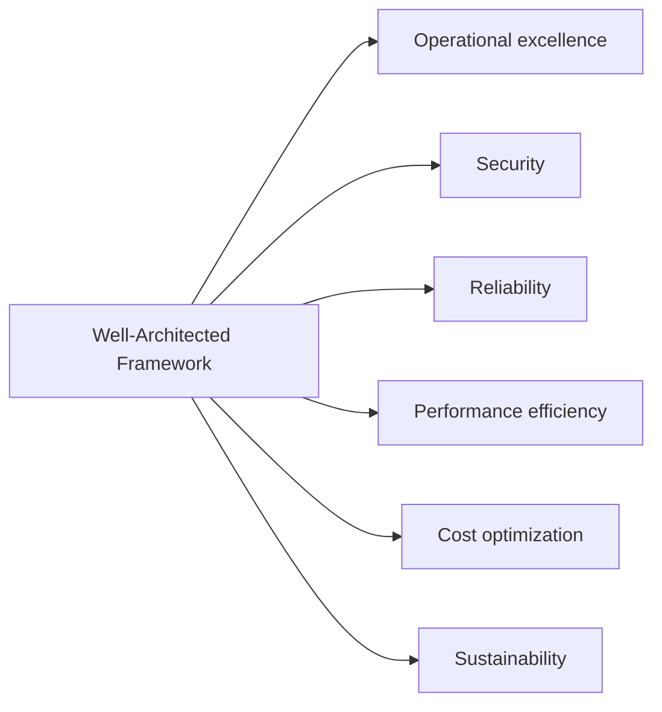

# Identify design principles of the AWS Cloud

This task covers the AWS Well-Architected Framework: a set of best practices for designing and operating workloads in the cloud. The exam expects you to name the six pillars, match a scenario to the right pillar, and tell similar pillars apart.

## Key concepts

### The AWS Well-Architected Framework

The framework gives architects a consistent way to measure a workload against proven practices and find areas to improve. It is organized into six pillars. Each pillar has design principles (general guidance) and best practices (specific actions). The framework does not prescribe one correct design. It asks questions about your workload so you can see trade-offs and risks. The AWS Well-Architected Tool in the console helps you run these reviews.

### The six pillars

- **Operational excellence** is about running and monitoring systems and continually improving processes. Principles include performing operations as code, making frequent, small, reversible changes, refining procedures often, anticipating failure, and learning from every operational event.
- **Security** is about protecting data, systems, and assets. Principles include a strong identity foundation (least privilege), traceability, security at all layers, automating security best practices, protecting data in transit and at rest, keeping people away from data, and preparing for security events.
- **Reliability** is the ability of a workload to perform its function correctly and recover from failures. Principles include automatically recovering from failure, testing recovery procedures, scaling horizontally to increase availability, stopping guessing capacity, and managing change through automation.
- **Performance efficiency** is about using computing resources efficiently to meet requirements and keeping that efficiency as demand and technology change. Principles include democratizing advanced technologies, going global in minutes, using serverless architectures, experimenting more often, and considering mechanical sympathy (choosing the technology that fits the goal).
- **Cost optimization** is about delivering business value at the lowest price point and avoiding unnecessary costs. Principles include implementing cloud financial management, adopting a consumption model (pay only for what you use), measuring overall efficiency, stopping spending on undifferentiated heavy lifting, and analyzing and attributing expenditure.
- **Sustainability** is about minimizing the environmental impact of running cloud workloads. Principles include understanding your impact, setting sustainability goals, maximizing utilization, adopting more efficient hardware and software, using managed services, and reducing the downstream impact of your workloads.

## Key terms

| Term                  | Meaning                                                                                      |
| --------------------- | -------------------------------------------------------------------------------------------- |
| Pillar                | One of six focus areas of the Well-Architected Framework                                     |
| Design principle      | High-level guidance within a pillar                                                          |
| Best practice         | A specific action that follows a design principle                                            |
| Workload              | A collection of resources and code that delivers business value                              |
| Least privilege       | Granting only the permissions needed to do a task                                            |
| Horizontal scaling    | Adding more small resources rather than making one resource larger                           |
| Undifferentiated work | Heavy lifting, such as managing data centers, that does not set your business apart          |
| Utilization           | How much of provisioned capacity is actually used; high utilization reduces waste and energy |

## Comparisons

| Pillar                 | Core question                                  | Typical signal in a scenario                          |
| ---------------------- | ---------------------------------------------- | ----------------------------------------------------- |
| Operational excellence | Can we run, monitor, and improve the workload? | Runbooks, infrastructure as code, small safe releases |
| Security               | Are data and systems protected?                | Least privilege, encryption, audit trails             |
| Reliability            | Does it recover and keep working?              | Failure recovery, multiple Availability Zones         |
| Performance efficiency | Are we using the right resources for the need? | Selecting instance types, serverless, going global    |
| Cost optimization      | Are we avoiding unnecessary spend?             | Right-sizing, pay-as-you-go, cost attribution         |
| Sustainability         | Are we minimizing environmental impact?        | Maximizing utilization, efficient hardware            |

Commonly confused pairs:

- **Reliability vs. performance efficiency:** reliability is about surviving and recovering from failure. Performance efficiency is about matching resources to demand and requirements.
- **Cost optimization vs. sustainability:** both reward high utilization and right-sizing, but one targets spend and the other environmental impact.
- **Operational excellence vs. security:** operations covers running and improving the workload. Security covers protecting it, though both favor automation.

## Exam tips

- Read for the goal in the scenario: failure recovery points to reliability, saving money to cost optimization, environmental impact to sustainability.
- "Perform operations as code" belongs to operational excellence, not security or reliability.
- There are six pillars. Sustainability is the newest one, and older material may list only five.
- Pillars involve trade-offs. Questions may ask which pillar a given action mainly supports.
- Questions test names and definitions, not detailed implementation steps.

## Learn more

- [The pillars of the framework - AWS Well-Architected Framework](https://docs.aws.amazon.com/wellarchitected/latest/framework/the-pillars-of-the-framework.html)
- [Security - AWS Well-Architected Framework](https://docs.aws.amazon.com/wellarchitected/latest/framework/security.html)
- [Reliability - AWS Well-Architected Framework](https://docs.aws.amazon.com/wellarchitected/latest/framework/reliability.html)
- [Performance efficiency - AWS Well-Architected Framework](https://docs.aws.amazon.com/wellarchitected/latest/framework/performance-efficiency.html)
- [Cost optimization - AWS Well-Architected Framework](https://docs.aws.amazon.com/wellarchitected/latest/framework/cost-optimization.html)
- [Sustainability - AWS Well-Architected Framework](https://docs.aws.amazon.com/wellarchitected/latest/framework/sustainability.html)
