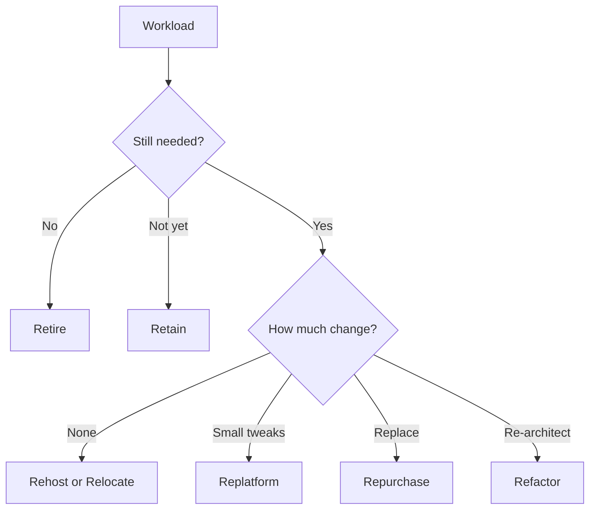

# Understand the benefits of and strategies for migration to the AWS Cloud

This task covers why organizations adopt the cloud, how AWS helps them plan the journey, and which migration strategy fits each workload. Expect scenario questions that describe a workload or a business goal and ask you to pick the strategy, framework perspective, or service that fits.

## Key concepts

### Cloud adoption strategies and the AWS CAF

The AWS Cloud Adoption Framework (AWS CAF) gives organizations guidance and best practices for planning and running a cloud transformation. It groups capabilities into six perspectives:

- **Business**: align cloud investments with business outcomes.
- **People**: training, culture, and organizational change.
- **Governance**: manage cloud initiatives, risk, and cost.
- **Platform**: design and build cloud architecture.
- **Security**: protect data and workloads.
- **Operations**: run and monitor workloads at the agreed service level.

The CAF ties cloud adoption to four business outcomes: **reduced business risk**, **improved environmental, social, and governance (ESG) performance**, **increased revenue**, and **increased operational efficiency**. A transformation typically moves through the phases Envision, Align, Launch, and Scale.

### Resources that support the journey

- **AWS Prescriptive Guidance**: strategies, guides, and patterns for migration.
- **AWS Professional Services**: AWS experts who work alongside your team.
- **AWS Partners** (AWS Partner Network): consulting and technology partners.
- **AWS Migration Acceleration Program (MAP)**: methodology, tooling, and funding to speed migrations.
- **AWS Training and Certification**: builds the skills the People perspective calls for.

### Migration strategies (the 7 Rs)

### Migration tools and database replication

- **AWS Database Migration Service (AWS DMS)** migrates databases to AWS. The source database stays operational during migration, and ongoing replication keeps the target in sync until cutover, which minimizes downtime. It supports homogeneous and heterogeneous migrations (with schema conversion for different engines).
- **AWS Application Migration Service** (AWS MGN, now AWS Transform MGN) rehosts servers by continuously replicating them to AWS.
- **AWS Snowball** moves large amounts of data offline on physical devices when network transfer is too slow.

## Key terms

| Term                  | Meaning                                                                                  |
| --------------------- | ---------------------------------------------------------------------------------------- |
| Rehost                | "Lift and shift": move servers as they are, without changes.                             |
| Replatform            | "Lift, tinker, and shift": small optimizations, such as moving a database to Amazon RDS. |
| Refactor              | Re-architect the application to use cloud-native features.                               |
| Repurchase            | Replace with a different product, usually SaaS.                                          |
| Relocate              | Move at the hypervisor level, such as VMware to VMware Cloud on AWS.                     |
| Retain                | Keep the workload where it is for now and revisit later.                                 |
| Retire                | Decommission a workload that is no longer needed.                                        |
| Homogeneous migration | Source and target database engines are the same type.                                    |

## Comparisons

| Need                                            | Pick                              |
| ----------------------------------------------- | --------------------------------- |
| Migrate a live database with minimal downtime   | AWS DMS                           |
| Rehost many servers with continuous replication | AWS Application Migration Service |
| Move tens of terabytes with poor bandwidth      | AWS Snowball                      |
| Fastest, least change                           | Rehost                            |
| Most cloud benefit, most effort                 | Refactor                          |
| Replace with SaaS                               | Repurchase                        |

## Exam tips

- Match the verb in the scenario to the R: "no changes" is Rehost, "replace with SaaS" is Repurchase, "re-architect" is Refactor, "no longer used" is Retire.
- A question about people, skills, or training points to the People perspective. Risk and cost control point to Governance.
- Database migration with the source still running points to AWS DMS.
- Retain and Retire both mean the workload is not migrated now. Retire removes it, Retain keeps it.

## Learn more

- [An Overview of the AWS Cloud Adoption Framework](https://docs.aws.amazon.com/whitepapers/latest/overview-aws-cloud-adoption-framework/welcome.html)
- [AWS Cloud Adoption Framework](https://aws.amazon.com/cloud-adoption-framework/)
- [AWS Cloud Adoption Framework: Business Perspective](https://docs.aws.amazon.com/whitepapers/latest/aws-caf-business-perspective/aws-caf-business-perspective.html)
- [About the migration strategies - AWS Prescriptive Guidance](https://docs.aws.amazon.com/prescriptive-guidance/latest/large-migration-guide/migration-strategies.html)
- [What is Cloud Migration? - Cloud Migration Explained - AWS](https://aws.amazon.com/what-is/cloud-migration/)
- [What is AWS Database Migration Service? - AWS Database Migration Service](https://docs.aws.amazon.com/dms/latest/userguide/Welcome.html)
- [What Is AWS Transform MGN? - AWS Transform MGN](https://docs.aws.amazon.com/mgn/latest/ug/what-is-mgn.html)
- [AWS Snowball | Secure Edge Computing and Offline Data Transfer | Amazon Web Services](https://aws.amazon.com/snowball/)
- [AWS Migration & Modernization | Cloud Transformation](https://aws.amazon.com/migration-and-modernization/)
