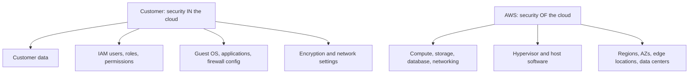

# Understand the AWS shared responsibility model

Security and compliance on AWS are split between AWS and the customer. This task covers who owns which layer, which controls are shared, and how the split moves depending on the service you use. Expect several scenario questions asking "who is responsible for X?"

## Key concepts

### The model

The AWS shared responsibility model divides work into two halves:

- **AWS is responsible for security _of_ the cloud.** This means the global infrastructure (Regions, Availability Zones, edge locations) and the hardware, software, networking and facilities that run AWS services.
- **The customer is responsible for security _in_ the cloud.** This depends on the services the customer chooses and how they configure and use them.

### Customer responsibilities

The customer always owns their **data**, who can access it (**IAM**: users, roles, policies, MFA), and the classification and encryption choices for that data. For services such as Amazon EC2, the customer also manages the guest operating system, patches, application software, and security group configuration. Customers also decide which Regions hold their data.

### AWS responsibilities

AWS protects the physical data centers (guards, access control, power, cooling), the hardware, the network backbone, and the virtualization layer. It also operates and patches the managed software of the services it runs, and it maintains compliance programs for the infrastructure.

### Shared controls

Some controls apply to both sides, each in its own context:

- **Patch management:** AWS patches the infrastructure; the customer patches their guest OS and applications.
- **Configuration management:** AWS configures its infrastructure devices; the customer configures their guest OS, databases and applications.
- **Awareness and training:** AWS trains its employees; the customer trains their own.

### How responsibility shifts by service

The more managed a service is, the more AWS takes on.

| Service type          | Example    | Customer still manages                                                                                                          |
| --------------------- | ---------- | ------------------------------------------------------------------------------------------------------------------------------- |
| Infrastructure (IaaS) | Amazon EC2 | Guest OS, patches, apps, security groups, data, IAM                                                                             |
| Managed service       | Amazon RDS | Data, IAM, security group and network access, database settings and parameters; AWS patches the OS and database engine software |
| Serverless            | AWS Lambda | Function code, IAM permissions, data; AWS manages OS, runtime patching and scaling                                              |
| Abstracted            | Amazon S3  | Data, bucket policies, encryption choices, IAM; AWS manages the platform                                                        |

## Key terms

| Term                   | Meaning                                                                                 |
| ---------------------- | --------------------------------------------------------------------------------------- |
| Security of the cloud  | AWS's duty to protect the infrastructure that runs all services                         |
| Security in the cloud  | The customer's duty to secure their data, access and configuration                      |
| Guest operating system | The OS installed on an EC2 instance, owned by the customer                              |
| Shared controls        | Controls that apply to both AWS and the customer, such as patch management              |
| Managed service        | A service where AWS operates the underlying infrastructure and often the software stack |
| IAM                    | The service the customer uses to control who can do what in an account                  |

## Comparisons

- **Amazon EC2 vs Amazon RDS:** On EC2 you patch the guest OS and the database software you install. On RDS, AWS patches the OS and database engine software (you choose maintenance windows), but you still control access, parameters and data.
- **Amazon EC2 vs AWS Lambda:** With Lambda there is no server or OS for you to patch. You remain responsible for code and permissions.
- **Patch management (shared) vs physical security (AWS only):** Patching is split between AWS and the customer, but customers never manage access to AWS data centers.

## Exam tips

- Look for the layer in the question. Hardware, facilities, hypervisor, and Region infrastructure point to AWS. Data, IAM, and guest OS point to the customer.
- "Of the cloud" means AWS; "in the cloud" means the customer.
- Data classification, encryption configuration and IAM permissions are customer responsibilities in every service.
- Patch management, configuration management, and awareness and training are the classic shared controls.
- The more abstract the service (Lambda, S3), the less the customer manages, but the customer never stops owning data and access.

## Learn more

- [Shared responsibility model - Amazon Web Services: Risk and Compliance](https://docs.aws.amazon.com/whitepapers/latest/aws-risk-and-compliance/shared-responsibility-model.html)
- [Shared Responsibility Model - Amazon Web Services (AWS)](https://aws.amazon.com/compliance/shared-responsibility-model/)
- [What is Amazon EC2? - Amazon Elastic Compute Cloud](https://docs.aws.amazon.com/AWSEC2/latest/UserGuide/concepts.html)
- [What is Amazon Relational Database Service (Amazon RDS)? - Amazon Relational Database Service](https://docs.aws.amazon.com/AmazonRDS/latest/UserGuide/Welcome.html)
- [What is AWS Lambda? - AWS Lambda](https://docs.aws.amazon.com/lambda/latest/dg/welcome.html)
