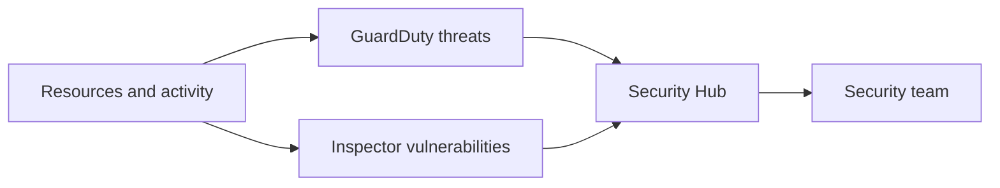

# Understand AWS Cloud security, governance, and compliance concepts

This task covers how AWS helps you stay secure and compliant: where to find compliance evidence, which services protect and monitor your resources, how encryption works, and which services give you logs and audit trails. Expect many "which service does this?" questions, so the goal is to match each need to the right service.

## Key concepts

### Compliance and governance

Compliance is shared. AWS maintains compliance of the cloud infrastructure and publishes audit reports. You remain responsible for configuring your workloads, data and access to meet your own obligations. Requirements differ by industry (for example healthcare or payments) and by geography (for example regional privacy laws). You choose the AWS Region where your content is stored, and AWS does not move it out of that Region unless you do. Not every AWS service is in scope for every compliance program, so check the services-in-scope information on the AWS compliance pages before building a regulated workload.

**AWS Artifact** is the self-service portal for AWS compliance reports (such as SOC reports and ISO certifications) and agreements. The AWS compliance pages describe the programs AWS supports.

### Benefits of cloud security and encryption

The cloud makes strong security easier to adopt: encryption is a feature you turn on, not infrastructure you build. There are two main kinds:

- **Encryption at rest** protects stored data, such as Amazon S3 objects or Amazon EBS volumes. Keys are commonly managed with AWS Key Management Service (AWS KMS).
- **Encryption in transit** protects data moving across a network, typically with TLS (HTTPS) or a VPN.

### Securing resources

- **Amazon GuardDuty** detects threats by analyzing account activity and network data.
- **Amazon Inspector** scans EC2 instances, container images and Lambda functions for software vulnerabilities.
- **AWS Security Hub** collects findings from security services into one view and checks against security standards.
- **AWS Shield** protects against DDoS attacks.

### Logging, monitoring and auditing

- **AWS CloudTrail** records API calls and account activity: who did what, when and from where.
- **Amazon CloudWatch** collects metrics and logs, and raises alarms. CloudWatch Logs is the common home for application and system logs.
- **AWS Config** records resource configurations over time and evaluates them against rules.
- Access reports, such as credential reports and last-accessed information in IAM, help you review who has access and what they use.

## Key terms

| Term                     | Meaning                                                              |
| ------------------------ | -------------------------------------------------------------------- |
| Compliance report        | Third-party audit evidence about AWS controls, found in AWS Artifact |
| Encryption at rest       | Protection of stored data                                            |
| Encryption in transit    | Protection of data while it moves over a network                     |
| AWS KMS                  | Service to create and manage encryption keys                         |
| Finding                  | A security issue reported by a service such as GuardDuty             |
| Services in scope        | AWS services covered by a given compliance program                   |
| Configuration compliance | Whether a resource meets a rule defined in AWS Config                |

## Comparisons

| Need                                                   | Service           |
| ------------------------------------------------------ | ----------------- |
| Who made this API call?                                | AWS CloudTrail    |
| What did this resource look like, and is it compliant? | AWS Config        |
| Is CPU high, or what do the app logs say?              | Amazon CloudWatch |
| Are there threats in my account?                       | Amazon GuardDuty  |
| Does my workload have known vulnerabilities?           | Amazon Inspector  |
| One view of all security findings                      | AWS Security Hub  |
| Defend against DDoS                                    | AWS Shield        |
| Download AWS audit reports                             | AWS Artifact      |

## Exam tips

- "Who" points to CloudTrail. "What changed or is it compliant" points to AWS Config. "Metrics, alarms and logs" points to CloudWatch.
- Vulnerabilities in workloads are Inspector. Active threats are GuardDuty. Aggregation is Security Hub.
- AWS compliance documents always come from AWS Artifact, not from tools that scan your own resources.
- Decide whether data is stored (at rest) or moving (in transit) before choosing an encryption answer.
- Data location rules are met by choosing a Region. Compliance of your workload is still your responsibility.

## Learn more

- [Security and compliance - Overview of Amazon Web Services](https://docs.aws.amazon.com/whitepapers/latest/aws-overview/security-and-compliance.html)
- [Shared responsibility model - Amazon Web Services: Risk and Compliance](https://docs.aws.amazon.com/whitepapers/latest/aws-risk-and-compliance/shared-responsibility-model.html)
- [Security Compliance Management - AWS Artifact - AWS](https://aws.amazon.com/artifact/)
- [Cloud Compliance - Amazon Web Services (AWS)](https://aws.amazon.com/compliance/)
- [What Is AWS CloudTrail? - AWS CloudTrail](https://docs.aws.amazon.com/awscloudtrail/latest/userguide/cloudtrail-user-guide.html)
- [What Is AWS Config? - AWS Config](https://docs.aws.amazon.com/config/latest/developerguide/WhatIsConfig.html)
- [What is Amazon CloudWatch? - Amazon CloudWatch](https://docs.aws.amazon.com/AmazonCloudWatch/latest/monitoring/WhatIsCloudWatch.html)
- [What is Amazon GuardDuty? - Amazon GuardDuty](https://docs.aws.amazon.com/guardduty/latest/ug/what-is-guardduty.html)
- [What is Amazon Inspector? - Amazon Inspector](https://docs.aws.amazon.com/inspector/latest/user/what-is-inspector.html)
- [Introduction to AWS Security Hub CSPM - AWS Security Hub](https://docs.aws.amazon.com/securityhub/latest/userguide/what-is-securityhub.html)
- [AWS Key Management Service](https://docs.aws.amazon.com/kms/latest/developerguide/overview.html)
- [Security - AWS Well-Architected Framework](https://docs.aws.amazon.com/wellarchitected/latest/framework/security.html)
