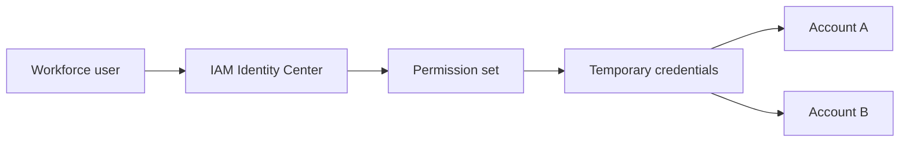

# Identify AWS access management capabilities

This task covers how AWS controls who can sign in and what they can do: IAM, the root user, least privilege, IAM Identity Center, credential storage, and authentication methods. Expect several exam questions on root user protection, MFA, and choosing roles over long-term access keys.

## Key concepts

### IAM basics

AWS Identity and Access Management (IAM) controls authentication (who you are) and authorization (what you may do). Its building blocks:

- **Users** represent a person or application with long-term credentials.
- **Groups** are collections of users; attach a policy to the group and every member inherits it.
- **Roles** are identities with temporary credentials that trusted principals assume.
- **Policies** are JSON documents that allow or deny actions on resources.

Policy types include AWS managed policies (written by AWS for common job functions), customer managed policies (written by you, reusable), and inline policies (embedded in one identity). When a managed policy is broader than needed, write a custom one that names only the required actions and resources.

### Least privilege

Grant only the permissions needed for a task, and no more. Start narrow and add permissions when a need is shown. Avoid administrator access and wildcards for everyday work, because the impact of a mistake or stolen credential grows with permissions.

### The root user

The root user is the identity created with the account. It has unrestricted access that IAM policies cannot limit. Protect it:

- Enable MFA and use a strong, unique password.
- Do not create root access keys; delete any that exist.
- Do not use it for daily work.

Only a few tasks require root, such as closing the account, changing the account name, root email or root password, and restoring IAM user permissions when no one else can.

### Authentication methods

- **MFA** adds a second factor: virtual authenticator apps, FIDO security keys and passkeys, or hardware TOTP tokens.
- **IAM Identity Center** gives workforce users single sign-on to multiple accounts and applications through permission sets, with temporary credentials.
- **Federation** lets users from an external identity provider, such as a corporate directory, access AWS without separate IAM users.
- **Cross-account roles** let principals in one account assume a role in another and receive temporary credentials.

### Credentials and secrets

Access keys (an access key ID plus a secret access key) are long-term credentials for programmatic access; prefer roles and temporary credentials. An IAM password policy sets password length, complexity, and expiration for IAM users. Never hard-code secrets. Use AWS Secrets Manager (secret storage with automatic rotation) or AWS Systems Manager Parameter Store (configuration and encrypted parameters).

## Key terms

| Term                  | Meaning                                                            |
| --------------------- | ------------------------------------------------------------------ |
| Principal             | A person or workload that can make a request to AWS                |
| Trust policy          | Defines who can assume a role                                      |
| Permission set        | A template in IAM Identity Center that defines account permissions |
| Access key            | Long-term credential pair for programmatic access                  |
| Identity federation   | Using an external identity provider to sign in to AWS              |
| Temporary credentials | Short-lived credentials issued when a role is assumed              |

## Comparisons

| Need                                        | Use                               |
| ------------------------------------------- | --------------------------------- |
| Workforce single sign-on to many accounts   | IAM Identity Center               |
| Application on EC2 calling other services   | IAM role, not stored access keys  |
| Database password with automatic rotation   | AWS Secrets Manager               |
| App configuration values and simple secrets | Systems Manager Parameter Store   |
| Access to another account                   | Cross-account IAM role            |
| Permissions for many users at once          | IAM group with an attached policy |

## Exam tips

- "Only the root user can..." usually points to closing the account, changing root settings, or restoring IAM permissions.
- When a question mentions hard-coded or long-term keys, the answer is usually a role, temporary credentials, or a secrets service.
- "Least privilege" answers are the narrowest option, never AdministratorAccess or full access.
- Single sign-on for employees across accounts means IAM Identity Center, not IAM users in each account.
- MFA is the answer when the question asks how to add protection beyond a password.

## Learn more

- [What is IAM? - AWS Identity and Access Management](https://docs.aws.amazon.com/IAM/latest/UserGuide/introduction.html)
- [Security best practices in IAM - AWS Identity and Access Management](https://docs.aws.amazon.com/IAM/latest/UserGuide/best-practices.html)
- [AWS account root user - AWS Identity and Access Management](https://docs.aws.amazon.com/IAM/latest/UserGuide/id_root-user.html)
- [Root user best practices for your AWS account - AWS Identity and Access Management](https://docs.aws.amazon.com/IAM/latest/UserGuide/root-user-best-practices.html)
- [AWS Multi-factor authentication in IAM - AWS Identity and Access Management](https://docs.aws.amazon.com/IAM/latest/UserGuide/id_credentials_mfa.html)
- [IAM roles - AWS Identity and Access Management](https://docs.aws.amazon.com/IAM/latest/UserGuide/id_roles.html)
- [Policies and permissions in AWS Identity and Access Management - AWS Identity and Access Management](https://docs.aws.amazon.com/IAM/latest/UserGuide/access_policies.html)
- [What is IAM Identity Center? - AWS IAM Identity Center](https://docs.aws.amazon.com/singlesignon/latest/userguide/what-is.html)
- [What is AWS Secrets Manager? - AWS Secrets Manager](https://docs.aws.amazon.com/secretsmanager/latest/userguide/intro.html)
- [What is AWS Systems Manager? - AWS Systems Manager](https://docs.aws.amazon.com/systems-manager/latest/userguide/what-is-systems-manager.html)
