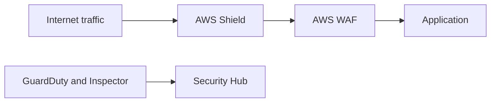

# Identify components and resources for security

This task covers the security services AWS offers, where to find security guidance, and how to pick the right tool for a stated need. Exam questions are usually short scenarios: match a requirement such as "block SQL injection" or "detect compromised instances" to the correct service.

## Key concepts

### Security capabilities AWS provides

AWS secures the cloud itself and gives customers services to secure what they run in it. These fall into a few groups:

- **Protection of web and network traffic:** AWS WAF, AWS Shield, AWS Firewall Manager.
- **Threat detection and assessment:** Amazon GuardDuty, Amazon Inspector, AWS Security Hub.
- **Guidance and checks:** AWS Trusted Advisor.
- **Identity, encryption and logging:** IAM, AWS KMS, AWS CloudTrail (covered in other tasks).

### Protecting applications and networks

- **AWS WAF** is a web application firewall. You write rules that allow, block or count web requests based on IP addresses, HTTP headers, URI strings, or patterns such as SQL injection and cross-site scripting. It attaches to Amazon CloudFront, an Application Load Balancer, Amazon API Gateway and similar resources.
- **AWS Shield** protects against distributed denial of service (DDoS) attacks. Shield Standard is automatic and free for all customers. Shield Advanced is a paid tier with extra detection, response support and cost protection.
- **AWS Firewall Manager** centrally configures and manages firewall rules (AWS WAF rules, Shield Advanced protections, security groups and more) across many accounts and resources in AWS Organizations.

### Detecting security issues

- **Amazon GuardDuty** is a threat detection service. It analyzes sources such as CloudTrail events, VPC flow logs and DNS logs to find suspicious activity, for example a compromised instance or unusual API calls.
- **Amazon Inspector** scans workloads such as Amazon EC2 instances, container images and Lambda functions for software vulnerabilities and unintended network exposure.
- **AWS Security Hub** collects and prioritizes findings from several AWS services and partner products and checks your setup against security standards.
- **AWS Trusted Advisor** inspects your account and recommends improvements in categories including cost optimization, performance, security, fault tolerance and service limits. Its security checks flag items such as open security groups and missing MFA on the root user. The full set of checks depends on your AWS Support plan.

### Third-party products and documentation

**AWS Marketplace** is a digital catalog where you can find, buy and deploy third-party software, including security products such as firewalls and endpoint protection. Billing appears on your AWS bill.

For security information:

- **AWS Security Center** and the **AWS Security Blog** publish best practices, announcements and security bulletins.
- **AWS Knowledge Center** (on AWS re:Post) holds answers to common support questions.
- AWS whitepapers and service documentation describe security features in depth.

## Key terms

| Term                  | Meaning                                                                           |
| --------------------- | --------------------------------------------------------------------------------- |
| Web application layer | Layer 7 traffic, such as HTTP requests, inspected by AWS WAF                      |
| DDoS                  | Distributed denial of service: an attack that floods a target to make it unusable |
| Finding               | A reported potential security issue from GuardDuty, Inspector or Security Hub     |
| Managed rule group    | A prebuilt set of AWS WAF rules maintained by AWS or a Marketplace seller         |
| Security policy       | A Firewall Manager policy applied across accounts in an organization              |

## Comparisons

| Need                                                   | Service              |
| ------------------------------------------------------ | -------------------- |
| Block malicious HTTP requests such as SQL injection    | AWS WAF              |
| Absorb DDoS attacks                                    | AWS Shield           |
| Apply firewall rules across all accounts               | AWS Firewall Manager |
| Detect suspicious activity and compromised resources   | Amazon GuardDuty     |
| Find software vulnerabilities on workloads             | Amazon Inspector     |
| View aggregated security findings and standards checks | AWS Security Hub     |
| Get best practice checks including security            | AWS Trusted Advisor  |
| Buy third-party security software                      | AWS Marketplace      |

## Exam tips

- GuardDuty **detects** threats and does not block them. WAF and Shield **protect** and block.
- "Vulnerabilities in EC2 instances or container images" points to Amazon Inspector. "Suspicious behavior or compromised account" points to GuardDuty.
- "Many accounts" or "AWS Organizations" with firewall rules points to AWS Firewall Manager.
- "Third-party" or "partner" security software means AWS Marketplace.
- Trusted Advisor is the answer when the question mentions best practice checks across cost, security and service limits.
- A question asking where to read security news or bulletins points to the AWS Security Blog or Security Center, and common how-to answers point to the Knowledge Center.

## Learn more

- [AWS WAF - AWS WAF, AWS Firewall Manager, AWS Shield Advanced, and AWS Shield network security director](https://docs.aws.amazon.com/waf/latest/developerguide/waf-chapter.html)
- [AWS Firewall Manager - AWS WAF, AWS Firewall Manager, AWS Shield Advanced, and AWS Shield network security director](https://docs.aws.amazon.com/waf/latest/developerguide/fms-chapter.html)
- [What is Amazon GuardDuty? - Amazon GuardDuty](https://docs.aws.amazon.com/guardduty/latest/ug/what-is-guardduty.html)
- [What is Amazon Inspector? - Amazon Inspector](https://docs.aws.amazon.com/inspector/latest/user/what-is-inspector.html)
- [AWS Trusted Advisor - AWS Support](https://docs.aws.amazon.com/awssupport/latest/user/trusted-advisor.html)
- [AWS Marketplace: Homepage](https://aws.amazon.com/marketplace)
- [Discover AWS Official Knowledge Center Articles | AWS re:Post](https://repost.aws/knowledge-center)
