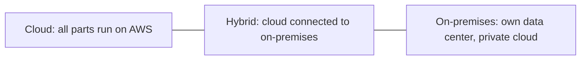

# Define methods of deploying and operating in the AWS Cloud

This task covers how you create, change and run resources on AWS, how you reach AWS services, and where workloads can run. Expect scenario questions that ask you to pick the access method or deployment model that fits a stated need, such as automation, repeatability or keeping data on premises.

## Key concepts

### Ways to access AWS services

Every action on AWS ends up as a call to an AWS service API. You can make those calls in three main ways:

- **AWS Management Console:** a web-based graphical interface. Best for learning, exploring and one-time tasks done by a person.
- **AWS Command Line Interface (AWS CLI):** a tool that manages AWS services through commands in a terminal. Commands can be saved in shell scripts, so it suits automation.
- **AWS SDKs:** language-specific libraries (for example Python, Java, JavaScript) that let application code call AWS services. Best when software, not a person, performs the action.

The CLI and SDKs are forms of **programmatic access**, which is what you use when a task must run without someone clicking in a browser.

### Provisioning and operating

- **Infrastructure as code (IaC)** means defining infrastructure in machine-readable files that tools apply for you. Because the definition is text, it can be reviewed, tested, stored in version control and reused.
- **AWS CloudFormation** is the AWS IaC service. You write a template (JSON or YAML) and CloudFormation creates, updates and deletes the resources together as a **stack**.
- **AWS Systems Manager** gives a central place to view operational data and automate tasks across Amazon EC2 instances, on-premises servers and other resources.
- **Amazon CloudWatch** collects metrics and logs and raises alarms so you can observe and operate what you have deployed.

### One-time operations versus repeatable processes

Ask how often the work happens and how much consistency matters. A single lookup or an afternoon of experimenting is fastest in the console. Anything repeated, such as identical development, test and production environments, per-customer stacks or disaster recovery rebuilds, should be automated with scripts or IaC to reduce human error and configuration drift.

### Deployment models

- **Cloud:** the application is fully deployed in the cloud.
- **Hybrid:** cloud resources are connected to existing resources that are not in the cloud, usually on-premises infrastructure. Companies use it to migrate in stages, keep data local or extend capacity.
- **On-premises:** resources run in the company's own facility, often with virtualization (sometimes called a private cloud). It lacks many cloud benefits but offers dedicated resources.
- **AWS Outposts** brings AWS infrastructure and services to on-premises or edge sites, giving a consistent hybrid experience.

## Key terms

| Term                   | Meaning                                                                     |
| ---------------------- | --------------------------------------------------------------------------- |
| API                    | The interface through which every AWS service action is requested           |
| Programmatic access    | Calling AWS through the AWS CLI, AWS SDKs or APIs rather than a GUI         |
| Infrastructure as code | Provisioning infrastructure from machine-readable definition files          |
| Template and stack     | The CloudFormation definition file and the group of resources it creates    |
| Drift                  | Differences that build up between environments that were configured by hand |
| Hybrid deployment      | Cloud resources connected to resources outside the cloud                    |

## Comparisons

| Need                                         | Best fit                 |
| -------------------------------------------- | ------------------------ |
| One-time lookup or exploration               | AWS Management Console   |
| Shell script or scheduled automation         | AWS CLI                  |
| Application code calling AWS                 | AWS SDKs                 |
| Identical, repeatable, reviewed environments | AWS CloudFormation (IaC) |
| Run AWS services in your own data center     | AWS Outposts (hybrid)    |
| Central operations across servers            | AWS Systems Manager      |

## Exam tips

- "Repeatable", "consistent", "version control" or "same in every Region" points to IaC with AWS CloudFormation.
- "Terminal", "script" or "automate from a shell" points to the AWS CLI; "from application code" points to an SDK.
- "Quick, one-time" or "graphical" points to the AWS Management Console.
- Hybrid requires a connection between cloud and on-premises resources. All on AWS is cloud; all local is on-premises.
- CloudWatch observes resources, CloudFormation provisions them, and Systems Manager operates them. Do not swap these.

## Learn more

- [Types of cloud computing - Overview of Amazon Web Services](https://docs.aws.amazon.com/whitepapers/latest/aws-overview/types-of-cloud-computing.html)
- [What is Cloud Computing? - Cloud Computing Services, Benefits, and Types - AWS](https://aws.amazon.com/what-is-cloud-computing/)
- [What is the AWS Command Line Interface? - AWS Command Line Interface](https://docs.aws.amazon.com/cli/latest/userguide/cli-chap-welcome.html)
- [AWS Management Console](https://docs.aws.amazon.com/awsconsolehelpdocs/latest/gsg/)
- [What is CloudFormation? - AWS CloudFormation](https://docs.aws.amazon.com/AWSCloudFormation/latest/UserGuide/Welcome.html)
- [What is Infrastructure as Code? - IaC Explained - AWS](https://aws.amazon.com/what-is/iac/)
- [What is AWS Systems Manager? - AWS Systems Manager](https://docs.aws.amazon.com/systems-manager/latest/userguide/what-is-systems-manager.html)
- [What is Amazon CloudWatch? - Amazon CloudWatch](https://docs.aws.amazon.com/AmazonCloudWatch/latest/monitoring/WhatIsCloudWatch.html)
- [On Premises Private Cloud - AWS Outposts - AWS](https://aws.amazon.com/outposts/)
