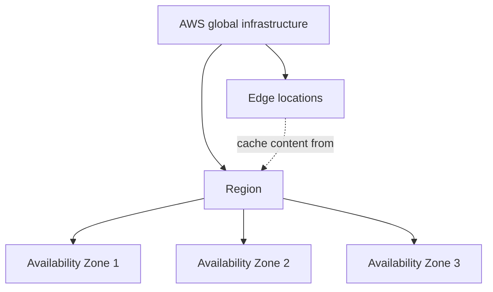

# Define the AWS global infrastructure

The AWS global infrastructure is built from Regions, Availability Zones, and edge locations. This task covers what each one is, how they relate, and how to use them to design for high availability, low latency, and compliance. Expect scenario questions that ask which layer solves a stated problem.

## Key concepts

### Regions, Availability Zones, and edge locations

- A **Region** is a geographic area where AWS clusters data centers. Regions are isolated from each other, and you choose the Region for each resource. Each Region has at least three Availability Zones.
- An **Availability Zone (AZ)** is one or more discrete data centers with redundant power, networking, and connectivity. AZs in a Region are physically separated, yet close enough to be linked by low-latency, high-bandwidth networking.
- **Edge locations** are points of presence around the world. Services such as Amazon CloudFront cache content there so users receive it from a nearby site.

### High availability with multiple AZs

High availability means a workload keeps running, with minimal downtime, when components fail. AZs do not share single points of failure: each has independent power, cooling, and physical security, so one zone failing does not take down the others. Run instances in at least two AZs and put a load balancer in front to survive the loss of a zone.

### When to use multiple Regions

Multi-Region designs cost more and are more complex, so use them for a clear reason:

- **Disaster recovery and business continuity** if a whole Region is unavailable.
- **Low latency** for users spread across continents.
- **Data sovereignty**, where laws require data to stay in a country. Data stays in the Region you choose unless you move it.

### Benefits of edge locations

Cached copies near viewers give lower latency and higher transfer rates. Repeat requests are answered from cache, which reduces load on the origin. On a cache miss, CloudFront fetches the object from the origin, such as an Amazon S3 bucket, and caches it.

## Key terms

| Term                    | Meaning                                                                        |
| ----------------------- | ------------------------------------------------------------------------------ |
| Region                  | Isolated geographic area containing multiple Availability Zones                |
| Availability Zone       | One or more data centers with independent power and networking inside a Region |
| Edge location           | Point of presence that caches content close to users                           |
| High availability       | Designing so a workload stays operational despite failures                     |
| Single point of failure | A component whose failure stops the whole workload                             |
| Data sovereignty        | Requirement that data stay within a particular country or jurisdiction         |
| AWS Outposts            | AWS infrastructure and services run at a customer's own site                   |

## Comparisons

| Need                                  | Best fit                                  |
| ------------------------------------- | ----------------------------------------- |
| Survive failure of a data center/zone | Multiple Availability Zones in one Region |
| Survive a Region-wide outage          | A second Region                           |
| Faster delivery of cacheable content  | Edge locations through Amazon CloudFront  |
| Keep data in a specific country       | Choose a Region in that country           |
| AWS infrastructure on premises        | AWS Outposts                              |

## Exam tips

- Hierarchy: a Region contains AZs. Edge locations are a separate layer, not inside Regions.
- "Highly available" usually points to multiple AZs. "Disaster recovery from a Region failure" points to multiple Regions.
- Adding more instances or a larger instance in one AZ never removes a single point of failure.
- Edge locations cache content. They do not host your databases or general compute.
- Choose a Region close to users to reduce latency, and choose a Region in a country to meet residency rules.

## Learn more

- [Global infrastructure - Overview of Amazon Web Services](https://docs.aws.amazon.com/whitepapers/latest/aws-overview/global-infrastructure.html)
- [Overview of Amazon Web Services](https://docs.aws.amazon.com/whitepapers/latest/aws-overview/introduction.html)
- [Regions and Zones - Amazon Elastic Compute Cloud](https://docs.aws.amazon.com/AWSEC2/latest/UserGuide/using-regions-availability-zones.html)
- [Global Infrastructure - AWS](https://aws.amazon.com/about-aws/global-infrastructure/)
- [Global Infrastructure Regions & AZs](https://aws.amazon.com/about-aws/global-infrastructure/regions_az/)
- [What is Amazon CloudFront? - Amazon CloudFront](https://docs.aws.amazon.com/AmazonCloudFront/latest/DeveloperGuide/Introduction.html)
- [What is High Availability? - High Availability Systems Explained - AWS](https://aws.amazon.com/what-is/high-availability/)
- [On Premises Private Cloud - AWS Outposts - AWS](https://aws.amazon.com/outposts/)
