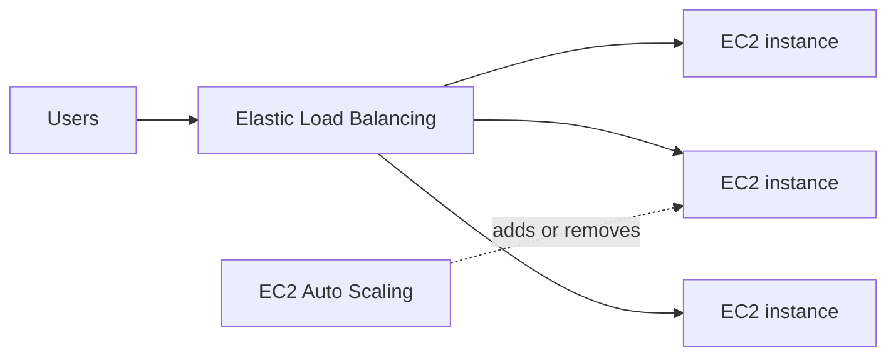

# Identify AWS compute services

Compute services supply the processing power that runs applications. This task asks you to match a workload to the right option: virtual servers, containers, or serverless functions. It also covers how Amazon EC2 Auto Scaling and Elastic Load Balancing keep applications elastic and available.

## Key concepts

### Amazon EC2 and instance types

Amazon EC2 provides resizable virtual servers called instances. You choose the operating system, software, and an instance type, and you are responsible for patching the guest OS. Instance types are grouped into families tuned for a workload:

- **General purpose:** balanced compute, memory, and networking. Good for web servers, small databases, and dev/test.
- **Compute optimized:** high-performance processors for batch processing, media transcoding, and scientific modeling.
- **Memory optimized:** large RAM for in-memory databases, caches, and real-time big data analytics.
- **Storage optimized:** high sequential read/write and IOPS on local storage for data warehouses and NoSQL databases.
- **Accelerated computing:** GPUs and other accelerators for machine learning and graphics.

### Containers

A container packages an application with its dependencies. AWS offers two orchestration services:

- **Amazon Elastic Container Service (Amazon ECS)** is the AWS-native service for running and scaling containers.
- **Amazon Elastic Kubernetes Service (Amazon EKS)** runs managed Kubernetes, which suits teams that already use Kubernetes tools and manifests.

Both can run containers on EC2 instances you manage or on AWS Fargate.

### Serverless compute

**AWS Lambda** runs your code in response to events such as an S3 upload, an API call, or a schedule. You do not manage servers, and you pay for the compute time the code uses. **AWS Fargate** is a serverless compute engine for containers: you define the CPU and memory a task needs and AWS runs it without you managing instances.

### Elasticity and load balancing

**Amazon EC2 Auto Scaling** adds instances when demand rises and removes them when demand falls, within minimum and maximum limits. This is elasticity: capacity follows demand, so you avoid both overload and idle spend. It also replaces unhealthy instances.

**Elastic Load Balancing** distributes incoming traffic across multiple targets, such as instances, containers, or IP addresses, in one or more Availability Zones. It runs health checks and sends traffic only to healthy targets.

## Key terms

| Term            | Meaning                                                                                 |
| --------------- | --------------------------------------------------------------------------------------- |
| Instance        | A virtual server running on Amazon EC2.                                                 |
| Instance family | A group of instance types tuned for a workload, such as compute optimized.              |
| Container       | A packaged application and its dependencies that runs consistently across environments. |
| Serverless      | A model in which AWS manages the servers and you focus on code.                         |
| Elasticity      | The ability to add and release resources as demand changes.                             |
| Health check    | A test a load balancer uses to decide whether a target can receive traffic.             |

## Comparisons

| Need                                      | Choose                  |
| ----------------------------------------- | ----------------------- |
| Full OS control, long-running application | Amazon EC2              |
| Short, event-driven code with no servers  | AWS Lambda              |
| AWS-native container orchestration        | Amazon ECS              |
| Kubernetes compatibility                  | Amazon EKS              |
| Containers without managing servers       | AWS Fargate             |
| Add or remove instances with demand       | Amazon EC2 Auto Scaling |
| Spread traffic across healthy targets     | Elastic Load Balancing  |

## Exam tips

- Match the keyword to the instance family: CPU or transcoding means compute optimized, in-memory means memory optimized, high IOPS or data warehouse means storage optimized, GPU or machine learning means accelerated computing.
- The word Kubernetes points to Amazon EKS. Without it, AWS-native container orchestration points to Amazon ECS.
- "Run containers without managing servers" points to AWS Fargate. "Run code without managing servers" points to AWS Lambda.
- Auto Scaling changes how much capacity exists. A load balancer spreads traffic across it. Do not swap them.
- Elasticity answers usually mention scaling out when demand rises and scaling in when it falls.

## Learn more

- [What is Amazon EC2? - Amazon Elastic Compute Cloud](https://docs.aws.amazon.com/AWSEC2/latest/UserGuide/concepts.html)
- [Amazon EC2 instance types - Amazon Elastic Compute Cloud](https://docs.aws.amazon.com/AWSEC2/latest/UserGuide/instance-types.html)
- [What is Amazon Elastic Container Service? - Amazon Elastic Container Service](https://docs.aws.amazon.com/AmazonECS/latest/developerguide/Welcome.html)
- [What is Amazon EKS? - Amazon EKS](https://docs.aws.amazon.com/eks/latest/userguide/what-is-eks.html)
- [What is AWS Lambda? - AWS Lambda](https://docs.aws.amazon.com/lambda/latest/dg/welcome.html)
- [What is Amazon EC2 Auto Scaling? - Amazon EC2 Auto Scaling](https://docs.aws.amazon.com/autoscaling/ec2/userguide/what-is-amazon-ec2-auto-scaling.html)
- [What is Elastic Load Balancing? - Elastic Load Balancing](https://docs.aws.amazon.com/elasticloadbalancing/latest/userguide/what-is-load-balancing.html)
