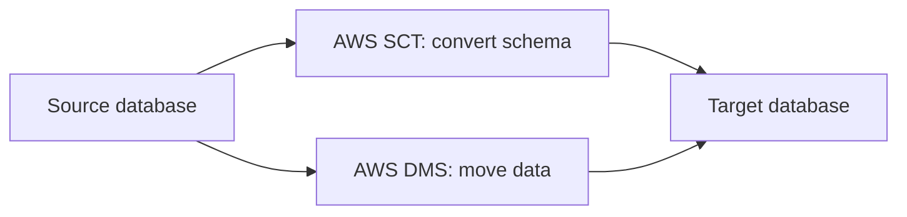

# Identify AWS database services

AWS offers purpose-built databases so that each workload can use the data model that fits it. This task covers choosing between self-managed and managed databases, recognizing the main database services, and knowing which tools move data between databases. Exam questions usually describe a need and ask for the matching service.

## Key concepts

### Managed databases or databases on Amazon EC2

You can install a database engine on an Amazon EC2 instance, but then you manage the operating system, patching, backups, replication and failover yourself. AWS managed databases handle provisioning, patching, backups and high availability, so your team focuses on schemas and queries. Choose EC2 only when you need full control, such as OS-level access or an unsupported engine or version. Otherwise a managed service reduces operational overhead.

### Relational databases

Relational databases store structured data in tables with a fixed schema and use SQL.

- **Amazon RDS** is a managed service for engines such as MySQL, PostgreSQL, MariaDB, Oracle Database, Microsoft SQL Server and Db2. It automates backups, patching and Multi-AZ failover.
- **Amazon Aurora** is a MySQL- and PostgreSQL-compatible relational database built for the cloud. Its storage is distributed across multiple Availability Zones, and it offers higher performance and availability than standard engines.
- **Amazon Redshift** is a data warehouse for analytics over large datasets, not for transactional workloads.

### NoSQL databases

- **Amazon DynamoDB** is a serverless key-value and document database with single-digit millisecond performance at any scale. Global tables replicate data across Regions.
- **Amazon DocumentDB (with MongoDB compatibility)** stores JSON-like documents and supports MongoDB workloads.

### Memory-based databases

- **Amazon ElastiCache** provides managed in-memory caching (Valkey, Redis OSS and Memcached) to speed up applications by reducing reads from slower databases.
- **Amazon MemoryDB** is a Valkey- and Redis OSS-compatible in-memory database that is durable, so it can be the primary database rather than only a cache.

### Database migration

- **AWS Database Migration Service (AWS DMS)** moves data between databases with minimal downtime, and the source database stays operational during the migration. It supports homogeneous migrations (same engine) and heterogeneous ones (different engines).
- **AWS Schema Conversion Tool (AWS SCT)** converts the schema and code of a source database to a format compatible with the target. It is typically paired with AWS DMS for heterogeneous migrations, for example Oracle to Aurora PostgreSQL.

## Key terms

| Term                    | Meaning                                                          |
| ----------------------- | ---------------------------------------------------------------- |
| Managed database        | A database where AWS handles patching, backups and failover      |
| Relational database     | Structured tables with a fixed schema, queried with SQL          |
| NoSQL database          | A non-relational model such as key-value or document             |
| In-memory database      | Data held in RAM for microsecond-level access                    |
| Homogeneous migration   | Source and target use the same engine                            |
| Heterogeneous migration | Source and target use different engines; the schema must convert |

## Comparisons

| Need                                          | Service            |
| --------------------------------------------- | ------------------ |
| Managed MySQL, PostgreSQL, Oracle, SQL Server | Amazon RDS         |
| Cloud-built, MySQL- or PostgreSQL-compatible  | Amazon Aurora      |
| Key-value at scale, serverless                | Amazon DynamoDB    |
| MongoDB-compatible documents                  | Amazon DocumentDB  |
| Cache in front of a database                  | Amazon ElastiCache |
| Durable in-memory primary database            | Amazon MemoryDB    |
| Analytics on large datasets                   | Amazon Redshift    |
| Move data between databases                   | AWS DMS            |
| Convert schema between engines                | AWS SCT            |

## Exam tips

- "Minimal operational overhead" or "no patching" points to a managed service, not a database on EC2.
- "Millisecond latency at any scale" with a key-value model points to DynamoDB.
- "Speed up reads" or "cache" points to ElastiCache; "durable in-memory primary database" points to MemoryDB.
- "Migrate with minimal downtime" is AWS DMS; "convert the schema" is AWS SCT.
- "Data warehouse" or "analytics queries" is Amazon Redshift, even though it uses SQL.

## Learn more

- [What is Amazon Relational Database Service (Amazon RDS)? - Amazon Relational Database Service](https://docs.aws.amazon.com/AmazonRDS/latest/UserGuide/Welcome.html)
- [What is Amazon Aurora? - Amazon Aurora](https://docs.aws.amazon.com/AmazonRDS/latest/AuroraUserGuide/CHAP_AuroraOverview.html)
- [What is Amazon DynamoDB? - Amazon DynamoDB](https://docs.aws.amazon.com/amazondynamodb/latest/developerguide/Introduction.html)
- [What is Amazon ElastiCache? - Amazon ElastiCache](https://docs.aws.amazon.com/AmazonElastiCache/latest/dg/WhatIs.html)
- [What is MemoryDB - Amazon MemoryDB](https://docs.aws.amazon.com/memorydb/latest/devguide/what-is-memorydb.html)
- [What is Amazon DocumentDB (with MongoDB compatibility) - Amazon DocumentDB](https://docs.aws.amazon.com/documentdb/latest/devguide/what-is.html)
- [What is Amazon Redshift? - Amazon Redshift](https://docs.aws.amazon.com/redshift/latest/mgmt/welcome.html)
- [What is AWS Database Migration Service? - AWS Database Migration Service](https://docs.aws.amazon.com/dms/latest/userguide/Welcome.html)
