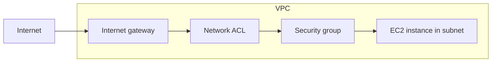

# Identify AWS network services

This task covers the building blocks of a network on AWS: the Amazon VPC and its components, the tools that secure it, DNS with Amazon Route 53, and the ways to connect outside networks to AWS. Expect scenario questions asking you to pick the right network service or filtering layer for a stated need.

## Key concepts

### Amazon VPC components

Amazon VPC is a logically isolated virtual network in the AWS Cloud. You choose its IP range and divide it into **subnets**, each living in a single Availability Zone. A subnet is **public** when its route table sends internet-bound traffic to an **internet gateway**; otherwise it is private. Route tables decide where traffic goes, and **AWS Transit Gateway** acts as a hub that interconnects many VPCs and on-premises networks.

### Security in a VPC

Security groups and network ACLs are two layers of traffic filtering. Security groups protect resources such as EC2 instances, have only allow rules and are stateful. Network ACLs protect whole subnets, have allow and deny rules evaluated in numbered order, and are stateless. **Amazon Inspector** is different: it does not filter traffic but scans EC2 instances, container images and Lambda functions for software vulnerabilities and unintended network exposure.

### Amazon Route 53

Route 53 is a highly available, scalable DNS service. It registers domains, translates names to IP addresses, performs health checks, and supports routing policies such as simple, weighted, latency-based and failover.

### Connectivity to AWS

**AWS Site-to-Site VPN** builds encrypted tunnels over the public internet and can be set up quickly. **AWS Direct Connect** is a dedicated private connection through a Direct Connect location that bypasses internet service providers and gives more consistent performance, but takes longer to provision.

## Key terms

| Term                 | Meaning                                                                    |
| -------------------- | -------------------------------------------------------------------------- |
| VPC                  | A logically isolated virtual network that you define in AWS                |
| Subnet               | A range of IP addresses in a VPC, located in one Availability Zone         |
| Internet gateway     | VPC component that enables communication between the VPC and the internet  |
| Security group       | Stateful, allow-only virtual firewall for resources such as instances      |
| Network ACL          | Stateless subnet-level filter with allow and deny rules                    |
| Amazon Inspector     | Vulnerability management service for EC2, container images and Lambda      |
| Amazon Route 53      | DNS service with domain registration, routing policies and health checks   |
| AWS Site-to-Site VPN | Encrypted tunnels between an on-premises network and AWS over the internet |
| AWS Direct Connect   | Dedicated private network connection from on premises to AWS               |
| AWS Transit Gateway  | Central hub connecting VPCs and on-premises networks                       |

## Comparisons

|            | Security group                  | Network ACL            |
| ---------- | ------------------------------- | ---------------------- |
| Applies to | Resources such as EC2 instances | Subnets                |
| Rule types | Allow only                      | Allow and deny         |
| State      | Stateful                        | Stateless              |
| Rule order | All rules evaluated             | Numbered, lowest first |

|             | Site-to-Site VPN                   | Direct Connect                      |
| ----------- | ---------------------------------- | ----------------------------------- |
| Path        | Public internet, encrypted tunnels | Dedicated private connection        |
| Setup       | Quick                              | Slower, needs a physical connection |
| Performance | Can vary with the internet         | More consistent                     |

Related services often confused with these: **Amazon CloudFront** caches content at edge locations for low-latency delivery, and **Elastic Load Balancing** distributes traffic across targets such as EC2 instances. Neither connects networks.

## Exam tips

- "Block a specific IP range" points to a network ACL, because only network ACLs can deny.
- "Stateful" means a security group; "stateless" means a network ACL.
- "Consistent performance, not over the internet" points to Direct Connect; "quickly, encrypted, over the internet" points to Site-to-Site VPN.
- "Public subnet" always comes down to a route to an internet gateway.
- Amazon Inspector finds weaknesses; it never blocks traffic.
- Route 53 is DNS, not a load balancer. Choose Elastic Load Balancing to spread traffic among instances.

## Learn more

- [What is Amazon VPC? - Amazon Virtual Private Cloud](https://docs.aws.amazon.com/vpc/latest/userguide/what-is-amazon-vpc.html)
- [Subnets for your VPC - Amazon Virtual Private Cloud](https://docs.aws.amazon.com/vpc/latest/userguide/configure-subnets.html)
- [Enable internet access for a VPC using an internet gateway - Amazon Virtual Private Cloud](https://docs.aws.amazon.com/vpc/latest/userguide/VPC_Internet_Gateway.html)
- [Control traffic to your AWS resources using security groups - Amazon Virtual Private Cloud](https://docs.aws.amazon.com/vpc/latest/userguide/vpc-security-groups.html)
- [Control subnet traffic with network access control lists - Amazon Virtual Private Cloud](https://docs.aws.amazon.com/vpc/latest/userguide/vpc-network-acls.html)
- [What is Amazon Inspector? - Amazon Inspector](https://docs.aws.amazon.com/inspector/latest/user/what-is-inspector.html)
- [What is Amazon Route 53? - Amazon Route 53](https://docs.aws.amazon.com/Route53/latest/DeveloperGuide/Welcome.html)
- [What is AWS Site-to-Site VPN? - AWS Site-to-Site VPN](https://docs.aws.amazon.com/vpn/latest/s2svpn/VPC_VPN.html)
- [What is Direct Connect? - AWS Direct Connect](https://docs.aws.amazon.com/directconnect/latest/UserGuide/Welcome.html)
- [What is AWS Transit Gateway for Amazon VPC? - Amazon VPC](https://docs.aws.amazon.com/vpc/latest/tgw/what-is-transit-gateway.html)
- [What is Amazon CloudFront? - Amazon CloudFront](https://docs.aws.amazon.com/AmazonCloudFront/latest/DeveloperGuide/Introduction.html)
- [What is Elastic Load Balancing? - Elastic Load Balancing](https://docs.aws.amazon.com/elasticloadbalancing/latest/userguide/what-is-load-balancing.html)
