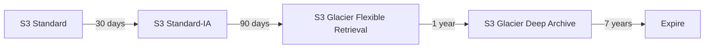

# Identify AWS storage services

This task covers the main AWS storage families (object, block and file), how Amazon S3 storage classes trade cost for access speed, how hybrid and cached storage works, and how lifecycle policies and AWS Backup automate data management. Exam questions are usually short scenarios that ask you to match a storage need to the right service or class.

## Key concepts

### Object storage

Object storage keeps data as objects (data plus metadata) in buckets, accessed over HTTPS APIs rather than mounted as a disk. Amazon S3 is the AWS object store. It scales without limit and is designed for 99.999999999% durability. Typical uses are backups, data lakes, static website content, media, software distribution and archives.

### Amazon S3 storage classes

You pick a class per object based on how often it is read and how fast it must be returned.

- **S3 Standard**: the default, for frequently accessed data with millisecond access.
- **S3 Intelligent-Tiering**: moves objects between access tiers automatically when access patterns are unknown or change. There are no retrieval fees, but a small monitoring fee applies.
- **S3 Standard-IA**: infrequently accessed data that still needs millisecond access, stored across multiple Availability Zones, with a retrieval fee.
- **S3 One Zone-IA**: the same idea in a single Availability Zone, so it is cheaper but not resilient to losing that zone. Use it for re-creatable data or replicas.
- **S3 Express One Zone**: single-digit millisecond access for latency-sensitive applications, in one Availability Zone.
- **S3 Glacier Instant Retrieval**: archive data read about once a quarter, with millisecond access.
- **S3 Glacier Flexible Retrieval**: archives retrieved in minutes to hours.
- **S3 Glacier Deep Archive**: the lowest-cost class, for data read less than once a year, with retrieval in hours.

### Block storage

Block storage presents raw volumes that an operating system formats like a local disk.

- **Amazon Elastic Block Store (Amazon EBS)** volumes attach to Amazon EC2 instances, persist independently of the instance, live in one Availability Zone and can be backed up with snapshots.
- **Instance store** is storage on disks physically attached to the host. It is very fast but temporary: data is lost when the instance stops, terminates or the underlying drive fails.

### File storage

File storage is shared and mounted over a network protocol.

- **Amazon Elastic File System (Amazon EFS)** is a serverless, elastic NFS file system for Linux workloads. Many compute resources can mount it at once, and it grows and shrinks automatically. Windows-based EC2 instances are not supported.
- **Amazon FSx** offers managed file systems built on popular technologies: FSx for Windows File Server (SMB), FSx for Lustre (high-performance computing), FSx for NetApp ONTAP and FSx for OpenZFS.

### Hybrid and cached storage

**AWS Storage Gateway** connects on-premises applications to AWS storage. It keeps frequently used data cached locally for low latency while the full data set lives in AWS, for example in Amazon S3. For bulk offline transfer, AWS Snowball moves data in a physical device.

### Lifecycle policies and AWS Backup

- **S3 Lifecycle** rules transition objects to cheaper classes after a set time, for example Standard to Standard-IA after 30 days and then to Glacier, or expire them entirely.
- **AWS Backup** is a central, policy-based service that automates backups across many AWS services, such as Amazon EBS, Amazon EFS and Amazon RDS, with retention rules and a single place to monitor.

## Key terms

| Term           | Meaning                                                          |
| -------------- | ---------------------------------------------------------------- |
| Object         | Data plus metadata stored in an S3 bucket and addressed by a key |
| Snapshot       | Point-in-time backup of an EBS volume                            |
| Instance store | Temporary block storage on the host's physical disks             |
| NFS            | Network File System protocol used by Amazon EFS                  |
| Lifecycle rule | Automatic transition or expiration of S3 objects by age          |
| Backup plan    | AWS Backup policy defining schedule and retention                |

## Comparisons

| Need                                        | Choose                             |
| ------------------------------------------- | ---------------------------------- |
| Shared Linux file system for many instances | Amazon EFS                         |
| Single-instance boot or database disk       | Amazon EBS                         |
| Fastest temporary scratch space             | Instance store                     |
| Windows file shares (SMB)                   | Amazon FSx for Windows File Server |
| Unknown access pattern                      | S3 Intelligent-Tiering             |
| Cheapest long-term archive                  | S3 Glacier Deep Archive            |
| Local cache in front of cloud storage       | AWS Storage Gateway                |

## Exam tips

- "Shared by many instances" points to EFS or FSx; "attached to one instance" points to EBS.
- Data that must survive instance termination does not belong on instance store.
- "Unpredictable access" means S3 Intelligent-Tiering; "re-creatable and cheap" suggests S3 One Zone-IA.
- "Automatically move or delete objects over time" means S3 Lifecycle; "centrally manage backups across services" means AWS Backup.
- Watch retrieval time: Deep Archive takes hours, Glacier Instant Retrieval is milliseconds.

## Learn more

- [What is Amazon S3? - Amazon Simple Storage Service](https://docs.aws.amazon.com/AmazonS3/latest/userguide/Welcome.html)
- [Understanding and managing Amazon S3 storage classes - Amazon Simple Storage Service](https://docs.aws.amazon.com/AmazonS3/latest/userguide/storage-class-intro.html)
- [Object Storage Classes – Amazon S3](https://aws.amazon.com/s3/storage-classes/)
- [What is Amazon Elastic Block Store? - Amazon EBS](https://docs.aws.amazon.com/ebs/latest/userguide/what-is-ebs.html)
- [What is Amazon Elastic File System? - Amazon Elastic File System](https://docs.aws.amazon.com/efs/latest/ug/whatisefs.html)
- [AWS Snowball | Secure Edge Computing and Offline Data Transfer | Amazon Web Services](https://aws.amazon.com/snowball/)
