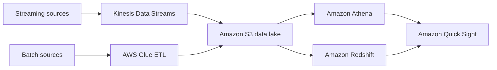

# Identify AWS artificial intelligence and machine learning (AI/ML) services and analytics services

This task asks you to match a business need to the right AI/ML or analytics service. Questions are short scenarios, so the main skill is knowing what each service takes as input and what it produces.

## Key concepts

### AI/ML services

- **Amazon SageMaker AI** is a managed platform to prepare data and build, train, and deploy your own machine learning models. Choose it when a team needs custom models.
- **Amazon Bedrock** is a fully managed service that gives API access to foundation models from Amazon and other leading AI companies, for building generative AI applications without managing model infrastructure.
- **Amazon Lex** builds conversational interfaces (chatbots) that understand voice and text, for example a bot that takes orders on a website or phone line.
- **Amazon Rekognition** analyzes images and video: it detects objects, scenes, and text, moderates unsafe content, and detects, analyzes, and compares faces. No ML expertise is needed.

These are ready-made or managed services: you call an API or use a console instead of building everything yourself. Only SageMaker AI is mainly about creating your own models.

### Analytics services

- **Amazon Athena** is a serverless query service that runs standard SQL on data in Amazon S3. You pay for the queries you run, so it suits ad hoc analysis.
- **Amazon Redshift** is a managed data warehouse for complex analytic queries on large structured datasets.
- **AWS Glue** is a serverless data integration service. Crawlers infer schemas into the AWS Glue Data Catalog, and ETL jobs extract, transform, and load data.
- **Amazon Kinesis Data Streams** ingests and processes large streams of records in real time, such as logs and clickstreams. It is part of the Kinesis family with Firehose, Kinesis Video Streams, and Managed Service for Apache Flink.
- **Amazon Quick Sight** is the business intelligence feature of Amazon Quick: interactive dashboards and visualizations built on connected data sources.

### How the analytics services fit together

## Key terms

| Term                  | Meaning                                                                      |
| --------------------- | ---------------------------------------------------------------------------- |
| Foundation model      | A large pretrained model that can be prompted for many generative AI tasks.  |
| ETL                   | Extract, transform, load: moving and reshaping data between stores.          |
| AWS Glue Data Catalog | Central metadata store describing tables and schemas for your data.          |
| Crawler               | A Glue component that scans a data store and infers schema information.      |
| Data warehouse        | A store optimized for analytic queries across large amounts of data.         |
| Real-time streaming   | Continuous ingestion and processing of records within seconds of arrival.    |
| Business intelligence | Tools that turn data into dashboards and visualizations for decision makers. |

## Comparisons

| If the scenario says...                       | Choose                      |
| --------------------------------------------- | --------------------------- |
| Build, train, and deploy custom ML models     | Amazon SageMaker AI         |
| Use existing foundation models through an API | Amazon Bedrock              |
| Chatbot with voice and text                   | Amazon Lex                  |
| Analyze images or video                       | Amazon Rekognition          |
| Ad hoc SQL on data in Amazon S3, no servers   | Amazon Athena               |
| Persistent data warehouse, complex analytics  | Amazon Redshift             |
| Discover schemas, run ETL, catalog data       | AWS Glue                    |
| Real-time ingestion of logs or clickstream    | Amazon Kinesis Data Streams |
| Dashboards for business users                 | Amazon Quick Sight          |

Athena versus Redshift: Athena queries data in place in S3 with no infrastructure, while Redshift is a warehouse you load data into for frequent, heavy analytics.

## Exam tips

- Look at the input type. Images or video point to Rekognition, voice or text conversations to Lex, and files in S3 queried with SQL to Athena.
- "Custom model" or "train" points to SageMaker AI. "Foundation models" or "generative AI through an API" points to Bedrock.
- "Real time" or "streaming" points to Kinesis Data Streams. Batch preparation of data points to Glue.
- Quick Sight only visualizes. It does not store, stream, or transform data.
- Separate the categories first: AI/ML (SageMaker AI, Bedrock, Lex, Rekognition) versus analytics (Athena, Redshift, Glue, Kinesis, Quick Sight). Many wrong options come from the other category.

## Learn more

- [What is Amazon SageMaker AI? - Amazon SageMaker AI](https://docs.aws.amazon.com/sagemaker/latest/dg/whatis.html)
- [Overview - Amazon Bedrock](https://docs.aws.amazon.com/bedrock/latest/userguide/what-is-bedrock.html)
- [What is Amazon Lex V2? - Amazon Lex](https://docs.aws.amazon.com/lexv2/latest/dg/what-is.html)
- [What is Amazon Rekognition? - Amazon Rekognition](https://docs.aws.amazon.com/rekognition/latest/dg/what-is.html)
- [What is Amazon Athena? - Amazon Athena](https://docs.aws.amazon.com/athena/latest/ug/what-is.html)
- [What is Amazon Redshift? - Amazon Redshift](https://docs.aws.amazon.com/redshift/latest/mgmt/welcome.html)
- [What is AWS Glue? - AWS Glue](https://docs.aws.amazon.com/glue/latest/dg/what-is-glue.html)
- [What is Amazon Kinesis Data Streams? - Amazon Kinesis Data Streams](https://docs.aws.amazon.com/streams/latest/dev/introduction.html)
- [What is Amazon Quick? - Amazon Quick](https://docs.aws.amazon.com/quick/latest/userguide/what-is.html)
