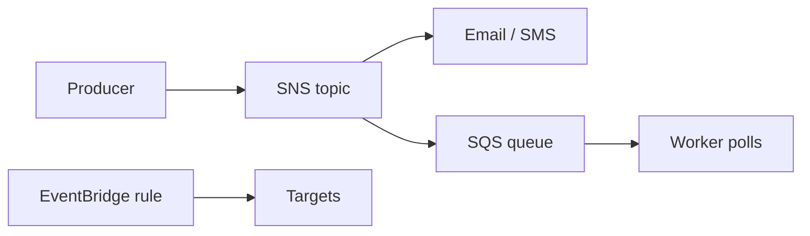

# Identify services from other in-scope AWS service categories

This task sweeps up the in-scope services that do not fit the compute, storage, database, or network categories: messaging, business applications, support, developer tools, end-user computing, frontend and mobile, and IoT. On the exam you usually match a short scenario to the one service built for that job, so knowing each service's one-line purpose is the key skill.

## Key concepts

**Application integration.** These services connect application components so they do not depend on each other directly.

- Amazon Simple Queue Service (Amazon SQS) is a managed message queue. Producers send messages, and consumers poll and process them at their own pace, which absorbs traffic spikes.
- Amazon Simple Notification Service (Amazon SNS) is publish/subscribe. One message sent to a topic is pushed to every subscriber, such as email, SMS, mobile push, or SQS queues.
- Amazon EventBridge is a serverless event bus. Rules match events from AWS services, your own applications, or SaaS partners and route them to targets, including on a schedule.

**Business applications.** Amazon Connect is a cloud contact center for voice and chat. Amazon Simple Email Service (Amazon SES) sends transactional and marketing email at scale.

**Customer enablement.** AWS Support plans give different levels of help. Basic Support is free and includes documentation, whitepapers, and AWS re:Post. Paid plans add engineer access, and Enterprise Support adds a designated Technical Account Manager (TAM) for proactive guidance. Match the plan to the assistance described.

**Developer tools.** AWS CodeBuild compiles code and runs tests. AWS CodePipeline automates release stages from source to deployment. AWS X-Ray traces requests through a distributed application so you can troubleshoot errors and latency.

**End-user computing.** These services run desktops or applications in AWS and stream the display to the user's device. Amazon WorkSpaces provides full virtual desktops. Amazon AppStream 2.0 streams individual applications. Amazon WorkSpaces Secure Browser provides a managed, secure browser for internal web apps.

**Frontend web and mobile.** AWS Amplify helps developers build, deploy, and host frontend web and mobile applications.

**IoT.** AWS IoT Core connects and manages IoT devices and routes their data to the cloud.

## Key terms

| Term                      | Meaning                                                            |
| ------------------------- | ------------------------------------------------------------------ |
| Decoupling                | Letting components communicate without direct dependency           |
| Publish/subscribe         | One publisher sends to a topic; all subscribers receive a copy     |
| Event bus                 | A channel that receives events and routes them to targets by rules |
| Technical Account Manager | A designated AWS advisor included with Enterprise Support          |
| Streaming (EUC)           | Running a desktop or app in AWS and displaying it on a user device |

## Comparisons

| Need                                  | Choose                           |
| ------------------------------------- | -------------------------------- |
| Buffer work for consumers to pull     | Amazon SQS                       |
| Push one message to many recipients   | Amazon SNS                       |
| Route events by rule or schedule      | Amazon EventBridge               |
| Send bulk email to customers          | Amazon SES                       |
| Run a contact center                  | Amazon Connect                   |
| Full cloud desktop                    | Amazon WorkSpaces                |
| Stream a single application           | Amazon AppStream 2.0             |
| Secure access to internal web apps    | Amazon WorkSpaces Secure Browser |
| Automate release workflow             | AWS CodePipeline                 |
| Trace and debug a running application | AWS X-Ray                        |

## Exam tips

- "Queue", "buffer", or "process at its own pace" points to SQS. "Notify many", "fan out", or "alerts to email and SMS" points to SNS. "React to events" or "schedule" points to EventBridge.
- A customer-facing phone or chat support center is Amazon Connect, not a messaging service. Customer email is SES.
- "Stream" an application or desktop to a user device means an end-user computing service. Decide between a full desktop (WorkSpaces), one application (AppStream 2.0), or web-only access (Secure Browser).
- A designated TAM means Enterprise Support. Free resources without a paid plan point to Basic Support.
- Separate building (CodeBuild), releasing (CodePipeline), and troubleshooting (X-Ray).

## Learn more

- [What Is Amazon EventBridge? - Amazon EventBridge](https://docs.aws.amazon.com/eventbridge/latest/userguide/eb-what-is.html)
- [What is Amazon SNS? - Amazon Simple Notification Service](https://docs.aws.amazon.com/sns/latest/dg/welcome.html)
- [What is Amazon Simple Queue Service? - Amazon Simple Queue Service](https://docs.aws.amazon.com/AWSSimpleQueueService/latest/SQSDeveloperGuide/welcome.html)
- [What is Connect Customer? - Amazon Connect Customer](https://docs.aws.amazon.com/connect/latest/adminguide/what-is-amazon-connect.html)
- [What is Amazon SES? - Amazon Simple Email Service](https://docs.aws.amazon.com/ses/latest/dg/Welcome.html)
- [AWS Support plan comparison – AWS Support features – AWS](https://aws.amazon.com/premiumsupport/plans/)
- [AI-powered cloud support – AWS Support plans – AWS](https://aws.amazon.com/premiumsupport/)
