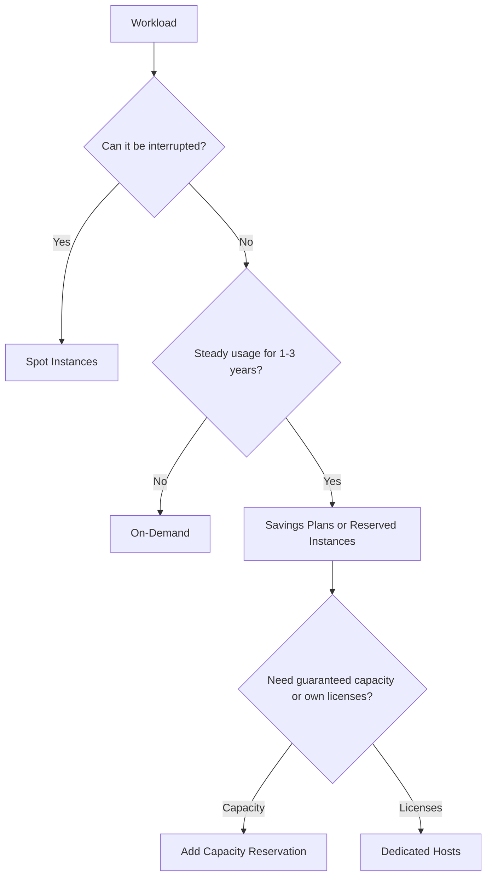

# Compare AWS pricing models

This task covers how you pay for AWS compute and storage, and which purchasing option fits which workload. Expect scenario questions that describe a workload's pattern (steady, spiky, interruptible, license-bound) and ask for the cheapest or most suitable option.

## Key concepts

### Compute purchasing options

- **On-Demand Instances:** pay per second or hour with no commitment. Best for short, unpredictable, or first-time workloads.
- **Reserved Instances (RIs):** commit to a one- or three-year term for a lower rate than On-Demand. Best for steady-state workloads.
- **Savings Plans:** commit to a consistent spend (dollars per hour) for one or three years. Compute Savings Plans apply regardless of instance family, Region, operating system, and tenancy, and also cover AWS Fargate and AWS Lambda. Savings of up to 72% are advertised.
- **Spot Instances:** use spare EC2 capacity at up to a 90% discount, but AWS can reclaim the capacity. Use them only for stateless, fault-tolerant, or flexible work such as batch jobs, CI/CD, and big data.
- **Dedicated Instances:** run on hardware reserved for one customer and isolated from other AWS accounts. You pay per instance plus a per-Region fee.
- **Dedicated Hosts:** a whole physical server for your use. You see sockets and cores and can keep instances on the same host, which supports per-socket or per-core bring-your-own licenses and some compliance needs. Billing is per host.
- **Capacity Reservations:** reserve capacity in a specific Availability Zone for any duration. An immediate-use reservation has no term commitment and gives no billing discount by itself. Combine it with Savings Plans or Regional RIs for a discount.

### Reserved Instance flexibility and AWS Organizations

- **Standard RIs** give the largest discount but the least flexibility. **Convertible RIs** let you exchange for a different instance family, operating system, or tenancy, for a slightly smaller discount.
- With consolidated billing in AWS Organizations, RI and Savings Plans discounts can apply to matching usage in any account in the organization. The management account can turn sharing off for individual accounts.

### Data transfer

- Data transfer **in** to AWS is free.
- Data transfer **out** to the internet is charged and tiered, so the per-GB price falls as volume grows.
- Transfer between Regions is charged. Transfer within a Region can still be charged, for example between Availability Zones, while traffic inside one Availability Zone over private IP addresses is generally free.

### Storage options and tiers

Amazon S3 storage classes trade price against access speed and retrieval cost:

- **S3 Standard:** frequent access, no retrieval fee.
- **S3 Intelligent-Tiering:** unknown or changing access patterns. It moves objects between tiers automatically and has a small monitoring charge.
- **S3 Standard-IA and S3 One Zone-IA:** infrequent access with a per-GB retrieval fee and a 30-day minimum duration. One Zone-IA uses a single Availability Zone, so use it only for re-creatable data.
- **S3 Glacier Instant Retrieval, Flexible Retrieval, and Deep Archive:** archives with 90-, 90-, and 180-day minimum durations. Deep Archive is the lowest cost, with retrieval within 12 hours.

## Key terms

| Term                     | Meaning                                                                                           |
| ------------------------ | ------------------------------------------------------------------------------------------------- |
| Commitment               | An agreement to use or spend a set amount over a one- or three-year term in return for a discount |
| Convertible RI           | A Reserved Instance that can be exchanged for different attributes                                |
| Tenancy                  | Whether instances share hardware (shared) or run on dedicated hardware                            |
| Minimum storage duration | Period for which you are billed even if you delete an object sooner                               |
| Tiered pricing           | Per-unit price decreases as usage volume increases                                                |

## Comparisons

| Need                                                             | Choose                |
| ---------------------------------------------------------------- | --------------------- |
| Unpredictable, short-lived workload                              | On-Demand             |
| Steady workload, maximum flexibility across families and Regions | Compute Savings Plans |
| Interruptible, fault-tolerant batch work                         | Spot Instances        |
| Per-socket or per-core license reuse                             | Dedicated Hosts       |
| Isolation from other accounts without host-level control         | Dedicated Instances   |
| Guaranteed capacity in one Availability Zone                     | Capacity Reservations |

## Exam tips

- "Fault-tolerant," "flexible start and end," or "can be interrupted" points to Spot. Never pick Spot for databases or critical stateful work.
- "Existing server-bound licenses" or "visibility of sockets and cores" points to Dedicated Hosts, not Dedicated Instances.
- A Capacity Reservation guarantees capacity, not a lower price.
- "Data transfer in is free" is a frequent true statement. Cross-Region and internet outbound are charged.
- "Unknown access patterns" points to S3 Intelligent-Tiering. "Rarely read for years" points to S3 Glacier Deep Archive.

## Learn more

- [AWS Product and Service Pricing | Amazon Web Services](https://aws.amazon.com/pricing/)
- [Cloud Cost Savings – Savings Plans – Amazon Web Services](https://aws.amazon.com/savingsplans/)
- [Save up-to 90% on On-Demand Prices – Amazon EC2 Spot Instances – Amazon Web Services](https://aws.amazon.com/ec2/spot/)
- [Dedicated Server Hosting - Amazon EC2 Dedicated Hosts - AWS](https://aws.amazon.com/ec2/dedicated-hosts/)
- [Amazon EC2 Dedicated Instances](https://aws.amazon.com/ec2/pricing/dedicated-instances/)
- [Reserve compute capacity with EC2 On-Demand Capacity Reservations - Amazon Elastic Compute Cloud](https://docs.aws.amazon.com/AWSEC2/latest/UserGuide/ec2-capacity-reservations.html)
- [Object Storage Classes – Amazon S3](https://aws.amazon.com/s3/storage-classes/)
- [Understanding and managing Amazon S3 storage classes - Amazon Simple Storage Service](https://docs.aws.amazon.com/AmazonS3/latest/userguide/storage-class-intro.html)
