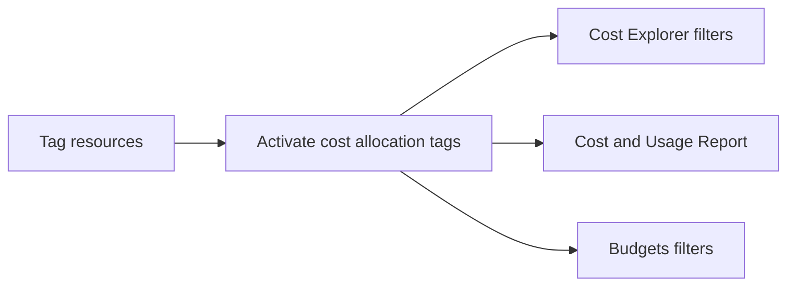

# Understand resources for billing, budget, and cost management

This task covers the tools AWS provides to see what you are spending, plan what you will spend, and attribute costs to teams or projects. Expect scenario questions that ask you to match a cost need to the right tool: forecast, alert, estimate, or allocate.

## Key concepts

### Billing information and support

AWS Billing and Cost Management is the console area where you view bills, pay invoices, and open the cost tools. The Bills page shows monthly charges by service. For questions about a bill or to appeal charges, you contact AWS Support rather than a technical forum.

### Pricing information

The AWS pricing pages describe how each service is charged. Most services are pay-as-you-go, with discounts for commitments such as Savings Plans and Reserved Instances. Do not memorize prices; know where to look them up.

### AWS Cost Explorer

AWS Cost Explorer is for analyzing past and current spending. You can view up to 13 months of historical data, forecast the next 18 months, filter and group by service, account, or tag, and receive Reserved Instance recommendations. Use it to answer "where did the money go?"

### AWS Budgets

AWS Budgets is for planning and alerting. You set a threshold and get notified (by email, an Amazon SNS topic, or both) when actual or forecasted spend crosses it. Budget types are cost, usage, and Reserved Instance or Savings Plans utilization and coverage. Budgets can also run budget actions, such as applying a restrictive IAM policy.

### AWS Pricing Calculator

AWS Pricing Calculator is a free web tool for estimating the cost of a workload before you build or expand it. You choose services, configurations, and usage, and it produces an exportable estimate. Use it for "what will this cost?"

### AWS Organizations and consolidated billing

AWS Organizations lets you manage many accounts centrally. The management account receives a single consolidated bill covering all member accounts and pays it. Combined usage across accounts can qualify for volume pricing tiers, and commitment discounts can be shared. Each account's charges remain visible, so costs can still be allocated to the right owner.

### Cost allocation tags

A tag is a key-value label. Cost allocation tags let you group costs by business category such as project or cost center.

- **AWS-generated tags** are created by AWS and use the `aws:` prefix (for example, `aws:createdBy`).
- **User-defined tags** are created by you and use the `user:` prefix in reports.

Both types must be activated in the Billing and Cost Management console before they appear in Cost Explorer or cost allocation reports. They can take up to 24 hours to appear. In an organization, only the management account can manage cost allocation tags. Active tags show up as columns in the monthly cost allocation report and in the AWS Cost and Usage Report, the most detailed billing dataset.

## Key terms

| Term                      | Meaning                                                                        |
| ------------------------- | ------------------------------------------------------------------------------ |
| Management account        | The Organizations account that pays the consolidated bill for all members      |
| Member account            | An account in an organization whose charges roll up to the management account  |
| Consolidated billing      | One bill for all accounts in an organization                                   |
| Cost allocation tag       | A tag activated for billing so costs can be grouped by it                      |
| AWS Cost and Usage Report | The most detailed report of AWS usage and cost, including active tags          |
| Budget action             | An automatic response, such as applying an IAM policy, when a threshold is hit |

## Comparisons

| Need                                               | Tool                      |
| -------------------------------------------------- | ------------------------- |
| Analyze and visualize past spend, forecast trends  | AWS Cost Explorer         |
| Get alerted when spend or usage passes a threshold | AWS Budgets               |
| Estimate the cost of a planned workload            | AWS Pricing Calculator    |
| One bill and combined discounts for many accounts  | AWS Organizations         |
| Group costs by project or team                     | Cost allocation tags      |
| Line-item detail for analysis                      | AWS Cost and Usage Report |

- Cost Explorer looks at what has happened; Budgets watches for what is about to happen; Pricing Calculator predicts what could happen.
- AWS-generated tags are applied by AWS; user-defined tags are applied by you. Both need activation.

## Exam tips

- "Alert me when costs exceed" points to AWS Budgets, not Cost Explorer.
- "Estimate before deploying" points to AWS Pricing Calculator.
- "Visualize and forecast spending" points to AWS Cost Explorer.
- A new tag does not appear in billing reports until it is activated, and tags apply going forward from activation unless backfilled.
- Consolidated billing is a feature of AWS Organizations and adds no extra charge for the feature.
- Member accounts cannot manage cost allocation tags; the management account does.

## Learn more

- [What is AWS Billing and Cost Management? - AWS Billing](https://docs.aws.amazon.com/awsaccountbilling/latest/aboutv2/billing-what-is.html)
- [Use AWS Billing and Cost Management for AWS - AWS Cost Management](https://docs.aws.amazon.com/cost-management/latest/userguide/what-is-costmanagement.html)
- [AWS Product and Service Pricing | Amazon Web Services](https://aws.amazon.com/pricing/)
- [Analyzing your costs and usage with AWS Cost Explorer - AWS Cost Management](https://docs.aws.amazon.com/cost-management/latest/userguide/ce-what-is.html)
- [Managing your costs with AWS Budgets - AWS Cost Management](https://docs.aws.amazon.com/cost-management/latest/userguide/budgets-managing-costs.html)
- [What is AWS Pricing Calculator? - AWS Pricing Calculator](https://docs.aws.amazon.com/pricing-calculator/latest/userguide/what-is-pricing-calculator.html)
- [What is AWS Organizations? - AWS Organizations](https://docs.aws.amazon.com/organizations/latest/userguide/orgs_introduction.html)
- [Cloud Administration – AWS Organizations – Amazon Web Services](https://aws.amazon.com/organizations/)
- [Organizing and tracking costs using AWS cost allocation tags - AWS Billing](https://docs.aws.amazon.com/awsaccountbilling/latest/aboutv2/cost-alloc-tags.html)
